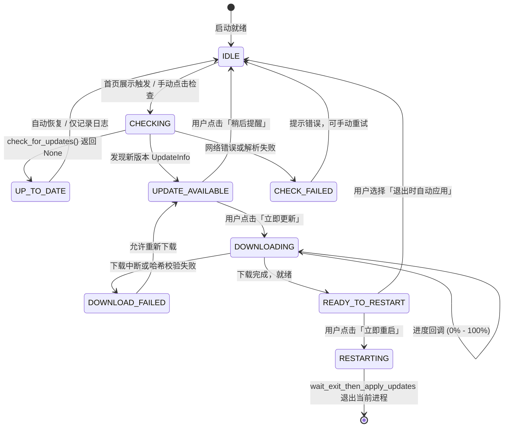

# ZenlessZoneZero-OneDragon 改用 Velopack 分发与自动升级技术设计

- **关联 Issue**：PLAY-2 / PLAY-3
- **目标分支**：`feat/velopack`
- **设计状态**：待评审（In Review - 返工修改版）

---

## 0. 工作区安全与主仓推送防护

- **执行环境**：工作区机器为 `arm-1`（aarch64 Linux），路径固定为 `/home/ubuntu/work/ZenlessZoneZero-OneDragon`。
- **防止误推主仓措施（Dev 阶段第一步执行）**：
  为彻底防止后续开发阶段或自动化脚本误触发向主仓的推送，**Dev 必须在进入任何代码编写前的第一步执行以下命令**：
  ```bash
  git remote set-url --push origin DISABLED
  ```
  执行后，任何向 `origin` 的 push 操作都会被 Git 客户端直接拒绝并报错（当前 arm-1 仓库已执行该配置生效），物理杜绝误推主仓风险。
- **远端推送纪律**：
  所有阶段一律**不推 fork、不配推送凭据、不跑 GitHub Actions**。arm-1 仅作为本地编辑与单测环境，代码只在本地分支 `feat/velopack` 提交，后续由人类直接拉取。

---

## 1. 改动清单

本清单覆盖父单 PLAY-2「落地要点 1–6」以及「尚未完成」全部任务项。

| 文件路径 | 变更类型 | 改动内容简述 | 关键接口签名 | 主要调用点 |
| :--- | :--- | :--- | :--- | :--- |
| `pyproject.toml` | 修改 | 添加 `velopack==1.2.161` 依赖项 | 声明依赖 | `uv sync`, `pip install` |
| `src/one_dragon/utils/os_utils.py` | 修改 | 适配 Velopack 目录层级契约与运行模式识别 | `get_velopack_root() -> Path \| None`<br>`is_velopack_mode() -> bool`<br>`get_bundle_dir() -> Path \| None`<br>`get_work_dir() -> str` | `app.py::main`<br>`bundle_seed.py`<br>`updater.py`<br>`git_service.py` |
| `src/one_dragon/utils/bundle_seed.py` | 新增 | 冻结环境首次启动与升级后资源初始化与配置补齐 | `ensure_work_dir_ready() -> None` | `src/zzz_od/gui/app.py::main()` |
| `src/one_dragon/utils/updater.py` | 新增 | Velopack Python SDK 封装（生命周期钩子、更新检查、下载与就地应用） | `init_velopack() -> None`<br>`is_supported() -> bool`<br>`get_update_source(project_config) -> IUpdateSource`<br>`check_for_updates() -> UpdateInfo \| None`<br>`download_and_apply(update_info, callback, restart=True) -> None` | `src/zzz_od/gui/app.py::main()`<br>`src/zzz_od/gui/view/home/home_interface.py` |
| `src/zzz_od/gui/app.py` | 修改 | 启动最早阶段插入 `init_velopack()` 与 `ensure_work_dir_ready()`；版本检查与遥测跳过 Git 调用 | `main() -> None`<br>`CheckVersionRunner.run() -> None` | 进程启动入口、主窗口初始化 |
| `deploy/OneDragon-Portable.spec` | 新增 | 单目录 PyInstaller 规范：全量收集 `src/`，嵌入四类只读资源与基础配置，集成 velopack 原生二进制 | PyInstaller Analysis / EXE / COLLECT | CI 构建流水线、开发者本地构建 |
| `src/one_dragon/envs/git_service.py` | 修改 | 在 Velopack 模式或缺失 `.git` 时全面短路，杜绝抛出 `ValueError` 及多源轮询重试 | `check_repo_exists() -> bool`<br>`is_current_branch_latest() -> tuple[bool, str]`<br>`fetch_total_commit() -> int`<br>`fetch_page_commit(page_num, page_size) -> list[GitLog]`<br>`get_current_version() -> str \| None`<br>`get_head_commit_id(short=False) -> str \| None`<br>`get_current_branch() -> str \| None`<br>`fetch_latest_code(...) -> tuple[GitSyncStatus, str]` | `CheckVersionRunner`<br>`CodeInstallCard`<br>`ResourceManagementInterface`<br>`telemetry_manager.py` |
| `src/one_dragon_qt/widgets/install_card/code_install_card.py` | 修改 | 界面卡片在 Velopack 模式下展示「发行版（自动升级）」，短路分支和同步按钮 | `get_display_content() -> tuple[QIcon, str]` | `ResourceManagementInterface` |
| `src/one_dragon_qt/view/resource_management_interface.py` | 修改 | 资源管理页隐藏/禁用 Git 代码卡片与旧启动器卡片，停用提交记录轮询线程 | `get_content_widget() -> QWidget`<br>`on_interface_shown() -> None` | 资源管理导航入口 |
| `src/one_dragon_qt/services/resource_update_coordinator.py` | 修改 | 在 Velopack 模式下取消向协调器注册旧版 `launcher` 检查任务 | `__init__(ctx, parent=None)` | 启动初始化聚合更新弹窗 |
| `src/zzz_od/telemetry/telemetry_manager.py` | 修改 | 遥测采集跳过 Git HEAD 查询，Velopack 模式下填充固定标识或空串 | `_get_commit_version() -> str` | `TelemetryManager.initialize()` |
| `src/zzz_od/gui/view/home/home_interface.py` | 修改 | 首页更新流程由旧启动器检查改为基于 `updater.py` 的异步更新状态流 | `_init_update_runner() -> None`<br>`_on_update_status_changed(...)` | `HomeInterface.on_interface_shown()` |
| `tools/ci/get_version.py` | 修改 | 输出版本号转为标准 SemVer 2.0.0（剥离 `v` 前缀供 Velopack 打包），Tag 保留 `v` 前缀 | `main() -> int` | GitHub Actions `version` job |
| `.github/workflows/build-release.yml` | 修改 | 移除旧多 spec 构建与 `src` 复制步骤；接入 `deploy/OneDragon-Portable.spec` 与 `vpk pack --runtime win-x64`；调整非发布构建路径与 SignPath 签名矩阵 | Actions YAML | CI/CD 发布流程 |
| `tools/ci/prepare_release_assets.py` | 修改 | 废除旧 RuntimeLauncher/Launcher 打包逻辑；生成独立的离线模型包 `ZenlessZoneZero-OneDragon-Models.zip` 并组织发布物料 | `main() -> int` | GitHub Actions `release` job |
| `deploy/generate_module_manifest.py` | 删除 | 移除已废弃的模块清单生成工具 | — | 原旧版 RuntimeLauncher |
| `deploy/module_manifest.py` | 删除 | 移除已废弃的模块清单文件 | — | 原旧版 RuntimeLauncher |
| `deploy/hook_path_inject.py` | 删除 | 移除外置 `src/` 路径注入运行时 hook | — | 原旧版 PyInstaller 动态路径扩展 |
| `deploy/OneDragon-RuntimeLauncher.spec` | 删除 | 移除集成版启动器 spec | — | 旧构建流程 |
| `deploy/OneDragon-Launcher.spec` | 删除 | 移除源码版启动器 spec | — | 旧构建流程 |
| `deploy/OneDragon-Installer.spec` | 删除 | 移除旧安装器 spec | — | 旧构建流程 |
| `src/one_dragon/launcher/runtime_launcher.py` | 修改 | 删除 `_sync_code()` 及其引发 Git 同步的代码逻辑，保留基础抽象或平滑过渡 | `_sync_code()` 移除 | 外部启动脚本 |
| `docs/develop/one_dragon/runtime_launcher.md` | 删除 | 移除已废弃的集成启动器开发设计文档 | — | 文档维护 |
| `src/one_dragon/utils/legacy_migration.py` | 新增（规划） | 旧数据探测、合法性校验、配置逆向合并、原子替换与重入标记模块 | `detect_legacy_dir() -> Path | None`<br>`is_valid_legacy_dir(path: Path) -> tuple[bool, str]`<br>`migrate_legacy_data(src: Path, dest: Path, on_progress=None) -> bool` | `src/zzz_od/gui/app.py::main()`<br>`SettingInterface` |

---

## 2. git_service 降级设计

### 2.1 报错根因与调用链定位

在冻结二进制（Frozen）运行模式下，分发目录不存在 `.git/` 文件夹。
当业务代码触发 Git 操作时，进入以下异常传播链：

1. **底层报错源**：
   `src/one_dragon/envs/git_service.py:608`
   ```python
   def _open_repo(self, refresh: bool = False) -> Repository:
       ...
       git_dir = discover_repository(self.repo_dir)
       if not git_dir:
           raise ValueError(f'目录 {self.repo_dir} 不是有效的 Git 仓库')
   ```
2. **多源回退与循环放大**：
   `src/one_dragon/envs/git_service.py:1208` (`_fetch_remote`)
   在进行远程同步或更新检查时，遍历 `_get_repository_candidates()` 候选列表（GitHub、Gitee、CNB 共 3 个代码源）。每个代码源均调用 `_fetch_remote_once()`（第 949 行 `repo = self._open_repo()`），捕获到 `ValueError` 后记录 warning 并附带完整异常堆栈（`exc_info=True`），导致 1 次检测产生 3 次严重日志污染。
   上层若有定时器或循环触发（如 50 秒内 72 轮检测），日志将瞬间被几百条 `ValueError` 刷屏。

### 2.2 调用链与短路方案对照表

| 序号 | 触发入口与调用链 | 当前源码位置（文件:行号） | 触发时机 | Velopack 模式下短路方案 |
| :--- | :--- | :--- | :--- | :--- |
| 1 | `GitService._open_repo` | `src/one_dragon/envs/git_service.py:608` | 任意底层 Git 操作 | 增加入口守卫：若 `is_velopack_mode()` 或 `discover_repository` 为空，直接抛出受控自定义异常或在公共 API 层截断，禁止进入 `Repository(git_dir)`。 |
| 2 | `GitService.is_current_branch_latest` | `src/one_dragon/envs/git_service.py:1730` | 状态检测、界面刷新 | 头部短路：<br>`if is_velopack_mode() or not self.check_repo_exists(): return True, ''`<br>直接声明已是最新，阻断 `_fetch_remote()` 多源循环。 |
| 3 | `GitService.fetch_total_commit` | `src/one_dragon/envs/git_service.py:1752` | 历史记录页初始化 | 头部短路：<br>`if is_velopack_mode() or not self.check_repo_exists(): return 0`<br>避免调用 `_get_commit_walker()`。 |
| 4 | `GitService.fetch_page_commit` | `src/one_dragon/envs/git_service.py:1760` | 版本日志分页查询 | 头部短路：<br>`if is_velopack_mode() or not self.check_repo_exists(): return []` |
| 5 | `GitService.get_current_version` | `src/one_dragon/envs/git_service.py:1826` | 启动版本展示、日志记录 | 头部短路：<br>`if is_velopack_mode() or not self.check_repo_exists(): return None`<br>（或返回应用打包内嵌版本 `__version__`），阻断 `fetch_page_commit(0, 1)`。 |
| 6 | `GitService.get_head_commit_id` | `src/one_dragon/envs/git_service.py:1721` | 遥测初始化、调试日志 | 头部短路：<br>`if is_velopack_mode() or not self.check_repo_exists(): return None` |
| 7 | `GitService.get_current_branch` | `src/one_dragon/envs/git_service.py:1708` | 卡片分支文本渲染 | 头部短路：<br>`if is_velopack_mode() or not self.check_repo_exists(): return None` |
| 8 | `GitService.get_latest_tag` | `src/one_dragon/envs/git_service.py:1833` | 旧启动器版本比对 | 当前第 1840 行已有 `if not self.check_repo_exists(): return '', ''`，但 `check_repo_exists()` 应前置判定 `if is_velopack_mode(): return False`，彻底避免 `discover_repository` 文件系统 I/O。 |
| 9 | `GitService.fetch_latest_code` | `src/one_dragon/envs/git_service.py:1692` | 用户点击手动代码同步 | 头部短路：<br>`if is_velopack_mode(): return GitSyncStatus.SUCCESS, '当前为自动升级版本，无需同步源码'` |
| 10 | `GitService.update_remote` | `src/one_dragon/envs/git_service.py:1791` | 代码源下拉切换时触发 | 头部短路：<br>`if is_velopack_mode() or not self.check_repo_exists(): return` |
| 11 | `GitService.reset_to_commit` | `src/one_dragon/envs/git_service.py:1803` | 版本回滚弹窗确认 | 头部短路：<br>`if is_velopack_mode() or not self.check_repo_exists(): return False, 'Velopack 模式不支持回滚'` |
| 12 | 启动版本线程 `CheckVersionRunner` | `src/zzz_od/gui/app.py:50` | 应用启动后主窗口加载 | 判断 `if is_velopack_mode(): code_version = "velopack"`，不调用 `git_service.get_current_version()`。 |
| 13 | 遥测管理器 `TelemetryManager._get_commit_version` | `src/zzz_od/telemetry/telemetry_manager.py:110` | 遥测事件上报（所有事件通用字段） | 修改为：<br>`if is_velopack_mode(): return "velopack"`<br>避免进入 `git_service.get_head_commit_id()`。 |
| 14 | 资源管理页代码卡片 `CodeInstallCard` | `src/one_dragon_qt/widgets/install_card/code_install_card.py:96, 104` | 资源管理界面显示 | 在 `get_display_content()` 中增加 `is_velopack_mode()` 分支：返回 `(FluentIcon.INFO, '已通过 Velopack 自动维护')`，禁用同步按钮；或在父容器中直接隐藏该卡片。 |
| 15 | 资源管理页初始化 `ResourceManagementInterface` | `src/one_dragon_qt/view/resource_management_interface.py:122, 616, 713` | 页面创建及展示 | 在 `is_velopack_mode()` 下，不启动 `fetch_total_runner`，隐藏 `self.code_card`、`self.launcher_opt`，隐藏「版本记录」与「代码设置」按钮。 |
| 16 | 聚合更新协调器 `ResourceUpdateCoordinator` | `src/one_dragon_qt/services/resource_update_coordinator.py:98` | 首页显示时触发检查 | `is_velopack_mode()` 下注销/跳过 `launcher` 维度的更新检查（不再调用 `update_service.is_launcher_update_available()`）。 |
| 17 | 首页旧更新检测（历史兼容） | `src/zzz_od/gui/view/home/home_interface.py:499`（原 `_check_code_runner`） | 首页展示 (`on_interface_shown`) | 说明：当前分支已在 v2.5.2 重构移除了历史上的 `_check_code_runner`，统一收拢至主窗口协调器。Velopack 更新将作为独立生命周期直接托管给 `updater.py`。 |

---

## 3. 首页更新流程与 UI 交互设计

### 3.1 现状与改造点分析

- **当前逻辑**：
  首页 `home_interface.py:499` 在 `on_interface_shown` 时调用主窗口的 `check_resource_updates()`。主窗口通过 `ResourceUpdateCoordinator` 分别对 `launcher`（旧启动器）、`project_models`（模型）和 `plugins` 进行后台线程检查。检查完成后，若存在更新且欢迎弹窗已关闭，弹出一个通用的 `ResourceUpdateDialog` 多选弹窗，用户勾选后放入进程内的 `DownloadQueueService` 串行下载。
- **Velopack 升级机制的根本区别**：
  Velopack 更新是整应用生命周期管理（基于 `UpdateManager` 与 `Update.exe`），更新包下载的是 `.nupkg` 增量或全量差分包，且更新应用需要调用 `wait_exit_then_apply_updates()`，在主进程退出后由外部进程原子替换 `current/` 目录并重启。它**不能也不应混入**通用的文件下载队列。

### 3.2 改造后状态机流转



### 3.3 组件复用方案（G1 评审通过落地项）

经过 Leader 判定，**本轮不派发 Designer**，100% 复用现有 Fluent 控件闭环实现更新流程：

1. **检查与发现阶段**：
   - 使用 `one_dragon_qt` 现有的 `InfoBar.info` 弹出浮层：
     - 标题：`发现新版本 vX.Y.Z`
     - 内容：`已有更新就绪，是否立即下载？`
     - 挂载自定义按钮：`PillPushButton('下载更新')` 与 `PushButton('忽略')`。
2. **下载进度阶段**：
   - 弹出标准 `MessageBoxBase` 派生的轻量进度弹窗，内嵌 `qfluentwidgets.ProgressBar` 与进度文本标签；或复用 `NoticeCard` 区域展示微型进度条。
3. **就绪与重启阶段**：
   - 弹出 `InfoBar.success` 或模态弹窗：
     - 标题：`更新已就绪`
     - 内容：`新版本已下载完毕，重启应用即可生效。`
     - 按钮：`立即重启`（触发退出并调用 `wait_exit_then_apply_updates`）和 `下次启动时应用`。

---

## 4. CI 改造与非发布构建设计

> [!NOTE]
> **执行约束说明**：
> 本设计文档包含完整的 `.github/workflows/build-release.yml`、`tools/ci/get_version.py`、`tools/ci/prepare_release_assets.py` 改造规范，并作为源码变更写入仓库。但在当前研发阶段中，**不推远端、不配置外部凭据、不实际触发 GitHub Actions 执行**。

### 4.1 `.github/workflows/build-release.yml` 改造前后步骤对照

```
改造前 (Legacy Build)                       改造后 (Velopack Build)
────────────────────────────────────────────────────────────────────────────
1. setup-python / uv sync                    1. setup-python / uv sync
2. UPX 下载与解压                            2. (移除 UPX，Velopack 官方建议禁用 UPX)
3. 打包三个可执行文件：                       3. PyInstaller 单目录构建：
   - OneDragon-Installer.spec                   - OneDragon-Portable.spec
   - OneDragon-Launcher.spec                      产物：deploy/dist/OneDragon/
   - OneDragon-RuntimeLauncher.spec
4. Copy-Item ..\src 到 RuntimeLauncher       4. (移除源码外置拷贝，代码已全量打包)
5. Bundle wheels (Environment.zip)          5. (移除 wheels 导出与打包)
6. 准备发布物料 (prepare_release_assets.py):  6. 安装 Velopack CLI：
   - 下载嵌入式 cpython 运行时                   - dotnet tool install -g vpk
   - 多次 zip 打包生成 Full/WithRuntime 等    7. 执行 vpk pack 打包，过程中自动调用签名钩子
                                                (--signTemplate / --signParams)，
                                                对 OneDragon.exe、Update.exe、Setup.exe
                                                在封包前一次性完成数字签名
                                             8. 构建离线模型包 (assets/models)
                                             9. 发布分支创建 Release 或非发布上传 Artifacts
```

### 4.2 非发布构建路径与正式发布隔离防护

为支持在 fork 仓手动测试（`workflow_dispatch`）或给 PR 打 `build` 标签进行构建检验，流水线必须具备严格的非发布构建路径与安全防护机制：

1. **触发条件与上下文环境变量**：
   ```yaml
   env:
     # 仅当为 tag 推送，或在主仓手动触发并显式勾选 create_release 时，才置为 true
     CREATE_RELEASE: ${{ github.repository_owner == 'OneDragon-Anything' && ((github.event_name == 'workflow_dispatch' && inputs.create_release == true) || startsWith(github.ref, 'refs/tags/v')) }}
   ```
2. **非发布构建逻辑（只出 Artifact，不建 Release、不跑 SignPath）**：
   - **打包与 Pack 正常执行**：在 `windows-latest` runner 上运行 PyInstaller 与 `vpk pack --runtime win-x64`（未配置签名钩子时输出未签名的测试包）。
   - **SignPath 门禁拦截**：
     ```yaml
     sign:
       if: ${{ env.CREATE_RELEASE == 'true' }}
     ```
     非发布构建跳过所有 SignPath 步骤，不需要任何 `SIGNPATH_API_TOKEN` 或签名组织凭据。
   - **Artifact 收集与上传**：
     非发布构建时，通过 `actions/upload-artifact@v4` 将产物完整导出供下载验证：
     - `ZenlessZoneZero-OneDragon-Setup.exe`
     - `ZenlessZoneZero-OneDragon-win-Portable.zip`
     - `RELEASES`
     - `releases.win.json`
     - `*.nupkg`
   - **Release 门禁拦截**：
     ```yaml
     release:
       if: ${{ env.CREATE_RELEASE == 'true' }}
     ```
     彻底杜绝非发布构建误建 Release、打 Git Tag 或向 CNB 发起镜像同步。

### 4.3 规范 vpk pack 执行命令

在 Windows Runner 的 PowerShell 环境下，执行以下打包命令（发布模式挂接 `--signTemplate`，测试模式不带签名）：

```powershell
# 1. 安装并信任 vpk 工具
dotnet tool install -g vpk

# 2. 提取剔除前导 v 的 SemVer 2.0.0 版本号
$rawVersion = "${{ needs.version.outputs.version }}"
$semver = $rawVersion.TrimStart('v')

# 3. 执行打包（必须带 --runtime win-x64）
vpk pack `
  --packId "ZenlessZoneZero-OneDragon" `
  --packVersion "$semver" `
  --packDir "deploy\dist\OneDragon" `
  --mainExe "OneDragon.exe" `
  --icon "assets\ui\logo.ico" `
  --runtime win-x64 `
  --packTitle "ZenlessZoneZero-OneDragon" `
  --packAuthors "OneDragon-Anything" `
  --outputDir "deploy\dist\releases"
```

> [!WARNING]
> **关键约束**：
> 1. 必须带 `--runtime win-x64`。若省略，vpk 默认打包为 win-x86，将导致 64 位 CPython 动态库加载失败引发崩溃。
> 2. 版本号必须剔除前导 `v`（符合 SemVer 2.0.0 规范，如 `0.1.0-beta.1`）。

### 4.4 签名机制与 SignPath 整合规范（统一口径）

> [!CRITICAL]
> **签名顺序的核心问题与官方规范**：
> - **问题根因**：`Update.exe` 和主程序 `OneDragon.exe` 在 `vpk pack` 执行期间就会被封装进 `Portable.zip` 和 `.nupkg` 内部。如果在 `vpk pack` 之后单独对输出目录的 `Update.exe` 签名，压缩包内的 `Update.exe` 依然是**未签名状态**，导致便携版用户解压升级时触发系统拦截。
> - **官方文档出处**：Velopack 官方代码签名文档 `docs/packaging/signing.mdx`（[Signing | Velopack Documentation](https://github.com/velopack/velopack.docs/blob/master/docs/packaging/signing.mdx)）

#### 机制说明
Velopack 官方原生支持在打包过程中对全部二进制执行原子签名钩子：
- `--signParams <PARAMS>`：使用系统 `signtool.exe`，将签名参数直接传递给签名工具（如 `/a /td sha256 /fd sha256`）。
- `--signTemplate <TEMPLATE>`：自定义签名命令模板，Velopack 在打包过程中自动将当前待签名二进制文件替换入 `{{file}}` 占位符。

#### 打包执行时 Velopack 的内置调用时序
1. **主程序签名**：遍历 `--packDir`，调用签名钩子对主程序（`OneDragon.exe`）及原生依赖完成签名；
2. **更新存根签名**：生成便携版更新存根 `Update.exe`，调用签名钩子对 `Update.exe` 完成签名；
3. **安全封包**：将上述已签名的 `OneDragon.exe` 与 `Update.exe` 封装进 `Portable.zip` 和 `.nupkg`；
4. **安装器签名**：编译安装向导 `Setup.exe`，并对最终的 `Setup.exe` 调用签名钩子完成签名。

#### CI 正式发布流水线中的 SignPath 接入方案
CI 在正式发布（`CREATE_RELEASE == 'true'`）时，通过 `--signTemplate` 调用 SignPath 逐文件签名脚本或本地代理工具：
```powershell
# 编写轻量签名桥接脚本 tools/ci/sign_file.py 调用 SignPath API
vpk pack `
  --packId "ZenlessZoneZero-OneDragon" `
  --packVersion "$semver" `
  --packDir "deploy\dist\OneDragon" `
  --mainExe "OneDragon.exe" `
  --runtime win-x64 `
  --signTemplate "python tools/ci/sign_file.py {{file}}" `
  --outputDir "deploy\dist\releases"
```
*(注：如果采用 GitHub Actions 云端打包签名，等效做法为：在 pack 前提取 `OneDragon.exe` 与 vpk 内置的 `Update.exe` 提交 SignPath 云端签名，回填已签名文件后再执行 pack，最后对产出的 `Setup.exe` 签名。无论何种做法，必须保证主 exe、Update.exe、Setup.exe 全部在封包闭环中受签名保护)*。

### 4.5 离线模型包来源、生成与解压契约

#### 来源定义与配置复用（精确代码位置）
离线模型包**严格复用现有代码库的声明与下载逻辑**，不新建独立配置或散落 URL：
- **配置来源**：`tools/ci/prepare_release_assets.py:214-250` 中的 `_MODEL_CONFIGS` 列表。
  具体包含 4 类必须模型：
  1. `ppocrv6`: 仓库 `OneDragon-Anything/OneDragon-Env`，文件名正则 `ppocrv6\.zip$`，目标目录 `assets/models/onnx_ocr`，降级下载地址为 `https://github.com/OneDragon-Anything/OneDragon-Env/releases/download/ppocrv6/ppocrv6.zip`。
  2. `flash`: 仓库 `OneDragon-Anything/OneDragon-YOLO`，文件名正则 `flash.*\.zip$`，目标目录 `assets/models/flash_classifier`，降级下载地址为 `https://github.com/OneDragon-Anything/OneDragon-YOLO/releases/download/zzz_model/yolov8n-640-flash-0127.zip`。
  3. `hollow`: 仓库 `OneDragon-Anything/OneDragon-YOLO`，文件名正则 `hollow.*\.zip$`，目标目录 `assets/models/hollow_zero_event`，降级下载地址为 `https://github.com/OneDragon-Anything/OneDragon-YOLO/releases/download/zzz_model/yolov8s-736-hollow-zero-event-0126.zip`。
  4. `lost_void_det`: 仓库 `OneDragon-Anything/OneDragon-YOLO`，文件名正则 `lost.*\.zip$`，目标目录 `assets/models/lost_void_det`，降级下载地址为 `https://github.com/OneDragon-Anything/OneDragon-YOLO/releases/download/zzz_model/yolov8n-736-lost-void-det-20250612.zip`。
- **下载实现逻辑复用**：直接调用 `tools/ci/prepare_release_assets.py:251` 中的现有函数：
  ```python
  def _download_models(model_base: Path, temp_dir: Path, *, token: str | None) -> None
  ```

#### Zip 目录结构与根层解压契约
离线模型包由 `tools/ci/prepare_release_assets.py:202` 的 `_write_dir_contents` 生成，内部具有严格的 `assets/models` 根前缀：
```text
ZenlessZoneZero-OneDragon-Models.zip
└── assets/
    └── models/
        ├── onnx_ocr/
        │   └── ppocrv6/
        ├── flash_classifier/
        │   └── yolov8n-640-flash-0127/
        ├── hollow_zero_event/
        │   └── yolov8s-736-hollow-zero-event-0126/
        └── lost_void_det/
            └── yolov8n-736-lost-void-det-20250612/
```
用户下载该附件后，解压到程序根目录 `<RootAppDir>`，文件将自动精准落入 `<RootAppDir>/assets/models/<类别>/<模型名>/...`，与应用运行时代码契约完全重合，实现解压即离线可用。

---

## 5. 验证矩阵

根据人类最终拍板意见：**验证矩阵精简为两栏，严谨划分「arm-1 上验到哪一步（mock 单测只证明逻辑，不等于验收通过）」与「交人类在 Windows 上验（未验，附可直接执行的步骤与断言）」**：

| 验收标准 | 栏目 1：arm-1 上验到哪一步（mock 单测只证明逻辑，不等于验收通过） | 栏目 2：交人类在 Windows 上验（未验，附可直接执行的步骤与断言） |
| :--- | :--- | :--- |
| **1. `vpk pack` 一条命令产出 `Setup.exe` 与 `Portable.zip`，两者都能装/解压后启动** | 1. 运行 `ruff check src/ deploy/ tools/` 校验代码规范；<br>2. 运行单测静态解析 `OneDragon-Portable.spec`，断言入口、datas 资源路径存在性；<br>3. 校验 `pyproject.toml` 语法。<br>*(不能在 arm-1 上构建 exe，不代表打包通过)* | **人类 Windows 验证步骤（同一份代码连续 pack 两次完整命令）**：<br>1. 先在本仓库根目录 `uv sync --group dev` 生成并使用本仓库自己的 `.venv`（禁止复用别的仓库的 venv，否则本仓库声明但那份环境没装的依赖会被静默漏掉，实测漏过 `websocket-client`），再用 PyInstaller 构建单目录产物：<br>   `uv run pyinstaller deploy\OneDragon-Portable.spec --noconfirm --clean`<br>2. 打包第 1 个版本（`0.1.0-beta.1`）：<br>   `vpk pack --packId ZenlessZoneZero-OneDragon --packVersion 0.1.0-beta.1 --packDir deploy\dist\OneDragon --mainExe OneDragon.exe --runtime win-x64 --outputDir deploy\dist\releases`<br>3. 同一份代码打包第 2 个版本（`0.1.0-beta.2`，**输出到同一个 outputDir**）：<br>   `vpk pack --packId ZenlessZoneZero-OneDragon --packVersion 0.1.0-beta.2 --packDir deploy\dist\OneDragon --mainExe OneDragon.exe --runtime win-x64 --outputDir deploy\dist\releases`<br>4. 断言目录正确生成 `Setup.exe`、`win-Portable.zip`、`RELEASES`、`releases.win.json` 与 `.nupkg`；安装 Setup.exe 与解压 Portable 双击启动验证。 |
| **2. 解压到全新目录启动后，根层自动生成 `config/assets/custom/.log`，四类只读资源到位** | **单测 Mock 覆盖（只证明逻辑正确）**：<br>编写 `tests/test_bundle_seed.py`：<br>1. Mock `sys.frozen=True`, `sys.executable="/mock/app/current/OneDragon.exe"`, `sys._MEIPASS="/mock/bundle"`;<br>2. 模拟全新空目录执行 `ensure_work_dir_ready()`；<br>3. 断言四类只读目录文件复制与 `.bundle_seed_version` 写入。 | **人类 Windows 验证步骤（含直接粘贴的 PowerShell 计数命令）**：<br>1. 将生成的 `ZenlessZoneZero-OneDragon-win-Portable.zip` 解压至全新空目录（如 `C:\TestOneDragon`）；<br>2. 启动根层 `OneDragon.exe`，等待 30–60 秒完成首启播种；<br>3. **断言目录生成**：检查根层存在 `config`、`assets`、`custom`、`.log`；<br>4. **断言四类只读资源齐全（动态比对，不写死文件数）**：根层 `assets\<tree>` 的文件数必须等于包内 `current\_internal\resources\assets\<tree>` 的文件数——`deploy/OneDragon-Portable.spec` 的 datas 目标是 `resources/assets/<tree>`，PyInstaller 6 单目录模式收进 `_internal\`，Velopack 再整体放进 `current\`。逐项比对可直接粘贴：<br>   `foreach ($tree in 'template','ui','text','game_data') { $r = (Get-ChildItem -Path ".\assets\$tree" -Recurse -File -Force).Count; $p = (Get-ChildItem -Path ".\current\_internal\resources\assets\$tree" -Recurse -File -Force).Count; '{0,-10} 根层 {1,5} / 包内 {2,5}' -f $tree,$r,$p; if ($r -ne $p) { exit 1 } }`<br>   参考值（按基线 `c2e3865b` 用 `git ls-tree -r c2e3865b --name-only assets/<tree>` 数出来：template 1948 / ui 5 / text 8 / game_data 159）只用于排查偏差，**不作为断言**，换基线不会假失败。<br>5. 验证完成后结束/终止进程。 |
| **3. 改根层 `config/project.yml` 后升级，改动保留、`current/` 被替换** | **单测 Mock 覆盖（只证明逻辑正确）**：<br>1. 预置含用户自定义字段（如 `test_key: custom_val`）的 `config/project.yml`；<br>2. 模拟新版本环境执行 `ensure_work_dir_ready()`；<br>3. 断言用户自定义配置未被覆盖，只读资源得到更新。 | **人类 Windows 验证步骤（就地升级断言）**：<br>1. 在第 2 步的运行环境中，修改根层 `config/project.yml`（追加一行 `test_custom_marker: "verified"`）；<br>2. 在命令行执行升级应用：<br>   `.\Update.exe apply -p deploy\dist\releases\ZenlessZoneZero-OneDragon-0.1.0-beta.2-full.nupkg --norestart`<br>3. **断言版本升级**：检查 `current/sq.version` 文件，确认内容已变为 `0.1.0-beta.2`；<br>4. **断言配置保留**：打开 `config/project.yml`，断言此前添加的 `test_custom_marker` 依然完好保留。 |
| **4. 完整日志里不再出现「不是有效的 Git 仓库」** | **单测 Mock 覆盖（只证明逻辑正确）**：<br>编写 `tests/test_git_service_fallback.py`：<br>1. Mock `is_velopack_mode() = True` 且工作目录无 `.git`；<br>2. 遍历调用 `is_current_branch_latest`、`fetch_total_commit`、`fetch_page_commit`、`get_current_version`、`get_head_commit_id`、`telemetry.initialize()`；<br>3. 断言日志中零次出现 `ValueError: 目录 xxx 不是有效的 Git 仓库` 且无多源重试 warning。 | **人类 Windows 验证步骤（日志检索）**：<br>1. 升级完成后，再次双击启动根层 `OneDragon.exe`；<br>2. 打开应用后正常浏览各界面约 1 分钟；<br>3. 在 PowerShell 执行日志检索：<br>   `Get-ChildItem -Path .\.log\*.log \| Select-String -Pattern "不是有效的 Git 仓库"`<br>4. **断言检索命中数为 0**。 |
| **5. 源码模式 `uv run src/zzz_od/gui/app.py` 行为与改造前一致** | **可直接执行的验证（arm-1 无显示器，只验路径解析与导入；GUI 显示交 Windows）**：<br>1. `PYTHONPATH=src uv run --no-project python -c "from one_dragon.utils import os_utils; print(os_utils.is_velopack_mode()); print(os_utils.get_work_dir())"` → 输出 `False` 与仓库根目录绝对路径（arm-1 装不出 win32 依赖，`uv run` 会被 lockfile 的 `sys_platform == 'win32'` 挡住，故用 `--no-project`）；<br>2. `PYTHONPATH=src uv run --no-project python -c "import zzz_od.gui.app"` 不抛异常（缺 PySide6 时模块自身的 try/except 会接住并置 `_init_error`，不算失败）；<br>3. 源码入口是 `src/zzz_od/gui/app.py`，仓库根目录**没有** `main.py`，验收口径不提 `main.py`。 | **人类 Windows 验证步骤**：<br>1. 在 Windows 开发环境拉取该分支并执行 `uv sync --group dev`；<br>2. 在仓库根目录运行 `uv run src/zzz_od/gui/app.py` 启动 GUI，测试核心自动化任务，确认与改造前完全一致。 |
| **6. 跑完清理掉启动的进程，不留后台** | **代码走查说明**：<br>代码走查 `updater.py` 与 `app.py::closeEvent` 退出逻辑。<br>*(注：此项在 arm-1 上仅为静态代码走查，不等于验收通过；冻结版进程清理交人类真机任务管理器验证)* | **人类 Windows 验证步骤**：<br>1. 启动 `OneDragon.exe` 运行任务，正常点击右上角关闭按钮退出应用；<br>2. 打开任务管理器（Task Manager）的「详细信息」页面；<br>3. **断言无残留进程**：确认无任何残留的 `OneDragon.exe`、`Update.exe` 或孤儿 Python 进程。<br>*注：对于「点击界面更新按钮、肉眼查看窗口渲染」等人工交互细节，直接标为「未验证，写入交付说明供人类验收确认」。* |

---

## 6. 风险评估与应对策略

### 6.1 签名与 Windows SmartScreen 拦截风险（统一口径）
- **风险**：
  若 SignPath 签名遗漏了 `Setup.exe`、`Update.exe` 或 `OneDragon.exe` 中的任何一个，用户在 Windows 10/11 安装或升级时将遭遇 SmartScreen 强力拦截甚至被杀毒软件误杀。尤其若在 `vpk pack` 之后才去签名输出目录中的 `Update.exe`，压缩包 `Portable.zip` 和 `.nupkg` 内部封存的 `Update.exe` 仍为未签名状态。
- **应对策略**：
  统一采用 Velopack 内置的 `--signTemplate` / `--signParams` 原生机制，在 `vpk pack` 执行期间由 Velopack 原子替换待打包的主程序二进制、包内及包外的 `Update.exe` 与编译生成的 `Setup.exe` 进行签名，彻底保证包内外所有二进制全部携带合法数字签名。

### 6.2 发布流水线与国内 CDN 同步风险
- **风险**：
  国内用户主要依赖 CNB 镜像源。Velopack 更新严重依赖 `releases.win.json`、`RELEASES` 以及 `.nupkg` 文件的完整性。如果 CNB Release 同步只同步了 exe 而漏掉了元数据文件，国内用户将全部升级失败。
- **应对策略**：
  更新 `.github/workflows/build-release.yml` 中的 CNB 同步触发逻辑，确保全量物料（包含 `releases.win.json`, `RELEASES`, 所有 `.nupkg`, `Setup.exe`, `Portable.zip`, `ZenlessZoneZero-OneDragon-Models.zip`）作为一个发布事务完整推送。

### 6.3 用户数据目录隔离与迁移破坏风险
- **风险**：
  Velopack 升级机制会在升级时彻底删除并重建 `current/` 文件夹。如果用户或开发人员不小心将数据存储在 `current/` 内部，升级后将导致用户数据永久丢失。
- **应对策略**：
  1. `get_work_dir()` 必须具备高可靠防护，确保在冻结状态下牢牢锚定在 `<RootAppDir>`。
  2. 单元测试针对 `get_velopack_root()` 进行详尽的边界与异常路径覆盖。

### 6.4 旧版本（集成版/源码版）用户的过渡风险
- **风险**：
  老用户目前处于「源码启动器 / 旧 RuntimeLauncher」体系，其目录结构与 Velopack 规范不兼容，无法通过应用内静默升级到 Velopack 版本。
- **应对策略**：
  1. **首发全量升级公告**：发布版本时在 Release Notes、QQ 群及公告卡片明确注明分发体系重构。
  2. **内置旧数据迁移向导**：详见本设计「第 7 节 旧数据迁移（Legacy Data Migration）」，首启时提供非静默确认的自动化数据迁移流程，保障老用户无缝过渡。


---

## 7. 旧数据迁移（Legacy Data Migration）

本节响应父单 PLAY-2 新增需求 1（首次启动时迁移旧数据），为老用户从旧形态平滑迁移至 Velopack 新架构提供技术设计方案。本阶段仅出设计方案、不编写功能代码。

### 7.1 旧形态数据位置调研

#### 7.1.1 两种旧形态工作目录判定机制与依据
旧架构存在「源码版」与「集成版（RuntimeLauncher）」两种发行形态。根据旧版核心路径判定函数 `get_work_dir()`（见基线 `c2e3865b:src/one_dragon/utils/os_utils.py:82-95`）：
```python
def get_work_dir() -> str:
    if _work_dir is not None:
        return str(_work_dir)
    if run_in_exe():
        return str(Path(sys.executable).resolve().parent)
    return str(Path(__file__).resolve().parents[3])
```
其中 `run_in_exe()`（`c2e3865b:src/one_dragon/utils/os_utils.py:70-76`）实现为：`return getattr(sys, 'frozen', False) and hasattr(sys, '_MEIPASS')`。

1. **源码版（`OneDragon-Launcher.exe` + `.install/.venv`）**：
   - **打包规范**：见 `git show c2e3865b:deploy/OneDragon-Launcher.spec:6`，入口为 `src/zzz_od/win_exe/launcher.py`，未捆绑应用代码与完整运行时。
   - **工作目录锁定**：启动时 `src/zzz_od/win_exe/launcher.py:17` 调用 `python_launcher.run_python(["zzz_od", "gui", "app"])`。在 `src/one_dragon/devtools/python_launcher.py:82-90` 的 `verify_working_directory()` 中：
     `if getattr(sys, 'frozen', False): cwd = str(Path(sys.executable).resolve().parent)` 并执行 `os.chdir(cwd)`，将当前工作路径显式锁定为可执行文件所在的旧安装根目录 `<old_root>`。
   - **子进程环境与执行**：`python_launcher.py:173` 调用 `uv run --frozen -m zzz_od.gui.app`，其环境配置见 `src/one_dragon/envs/env_config.py:10-12`（`DEFAULT_ENV_PATH = os_utils.get_path_under_work_dir('.install')`，`DEFAULT_UV_PATH = .../.install/uv/uv.exe`）。
   - **非冻结工作目录推导**：被唤起的 Python 子进程处于非冻结状态（`run_in_exe()` 为 `False`），`get_work_dir()` 执行 `c2e3865b:src/one_dragon/utils/os_utils.py:95` 的 `Path(__file__).resolve().parents[3]`。由于此时 `__file__` 位于 `<old_root>/src/one_dragon/utils/os_utils.py`，向上推导 3 层（`utils` -> `one_dragon` -> `src` -> `<old_root>`）精准命中旧安装根目录。

2. **集成版（RuntimeLauncher，外置 `src/`）**：
   - **架构设计与目录规范出处**：见 `git show c2e3865b:docs/develop/one_dragon/runtime_launcher.md:23-45`：
     ```
     安装目录/
     ├── OneDragon-RuntimeLauncher.exe    ← 启动入口
     ├── .runtime/                        ← Python 运行时 + 冻结模块
     └── src/                             ← 源代码目录（通过 git 同步）
     ```
     文档明确规范：可执行文件直接位于安装目录根层，Python 运行时和依赖落入 `.runtime/`，业务源码落入 `src/`。
   - **源码注入与启动入口**：`git show c2e3865b:deploy/hook_path_inject.py:15-28` 在启动早期将 `<old_root>/src` 注入 `sys.path`；`src/zzz_od/win_exe/runtime_launcher.py:10-18` 明确执行 `_SRC_DIR = Path(sys.executable).parent / "src"` 并在缺失时弹窗提示，反向证明了可执行文件与其同级的 `src/` 均位于同一安装根目录下。
   - **工作目录冻结分支**：集成版本身处于 PyInstaller 冻结环境（`run_in_exe()` 为 `True`），`get_work_dir()` 直接执行 `c2e3865b:src/one_dragon/utils/os_utils.py:93-94` 的冻结分支：`return str(Path(sys.executable).resolve().parent)`。由于 `sys.executable` 位于 `<old_root>/OneDragon-RuntimeLauncher.exe`，其父目录直接命中旧安装根目录 `<old_root>`。

- **调研结论**：在旧形态下，无论是源码版还是集成版，无论执行进程是否处于冻结模式，运行时的基准工作目录 `get_work_dir()` 均严格等价于旧安装根目录 `<old_root>`。

#### 7.1.2 用户数据在旧形态下的确切相对位置与迁移建议
经对全量代码梳理，用户在旧形态下产生的所有持久化与半持久化资产均以 `<old_root>` 为基准存放。具体位置与处理建议如下表所示：

| 数据类别 | 旧形态下的确切相对路径 | 代码出处依据（文件:行号） | 迁移建议 | 建议理由与说明 |
| :--- | :--- | :--- | :--- | :--- |
| **用户配置文件（根层与多实例）** | `<old_root>/config/*.yml`<br>`<old_root>/config/*.json`<br>`<old_root>/config/<instance_idx>/` | `src/one_dragon/base/config/yaml_config.py:60-66`<br>`src/one_dragon/base/config/json_config.py:40-44` | **必须迁移** | `_get_yaml_file_paths()` 在第 60–62 行拼出 `sub_dir = ['config']` 与实例子目录 `sub_dir.append('%02d' % self.instance_idx)`，并在第 66 行调用 `os_utils.get_path_under_work_dir(*sub_dir)` 构造完整路径。包含用户全部游戏账号、调度计划、自定义配置，丢失将导致用户需全量重新配置。 |
| **个性化素材** | `<old_root>/custom/` 全量内容<br>（典型如 `custom/assets/ui/banner`） | `src/one_dragon_qt/view/setting/setting_custom_interface.py:174`<br>`src/zzz_od/gui/view/home/home_interface.py:871`<br>`.gitignore:57` | **必须迁移** | `setting_custom_interface.py:174` 保存用户自定义主页横幅到 `os_utils.get_path_under_work_dir('custom', 'assets', 'ui', 'banner')`；`home_interface.py:871` 从该路径读取并渲染。属于用户私有素材与个性化产物。 |
| **已下载 AI 模型** | `<old_root>/assets/models/`<br>（包含 `onnx_ocr/`, `flash_classifier/`, `hollow_zero_event/`, `lost_void_det/` 等） | `src/one_dragon/base/matcher/ocr/onnx_ocr_matcher.py:39`<br>`src/one_dragon/utils/yolo_config_utils.py:9`<br>`src/zzz_od/yolo/flash_classifier.py:48` | **必须迁移** | YOLO 目标检测、OCR 识别等本地模型文件，总计百 MB 以上。迁移可避免老用户重新下载耗时及因 GitHub/网络波动造成的下载失败。 |
| **历史运行日志** | `<old_root>/.log/`<br>（如 `log.txt`, `one_dragon.log`, `python_launcher_framework.log`） | `src/one_dragon/utils/log_utils.py:145`<br>`src/one_dragon/devtools/python_launcher.py:65` | **不迁移** | 历史调试诊断数据，体积往往庞大且碎片较多；新包首启已由 `bundle_seed.py` 初始化全新的 `.log/` 目录记录新生命周期。 |
| **第三方插件目录** | `<old_root>/plugins/`<br>（用户手动放置或克隆的第三方插件仓库） | `src/one_dragon/base/operation/application/application_factory_manager.py:7`<br>`src/one_dragon/base/config/plugin_subscription_config.py:3` | **不自动迁移**<br>（设置页提示手动安装） | 第三方插件依赖 Python 源码动态执行，且可能依赖未打包在 Velopack 中的外部库，直接迁移可能引发未捕获的 `ImportError` 崩溃。插件配置已在 `config/` 中保留，用户应在新版启动后通过插件商店重新订阅安装。 |
| **临时截图与调试产物** | `<old_root>/.debug/`<br>（如 `.debug/images/*.png`） | `src/one_dragon/utils/debug_utils.py:27`<br>`src/one_dragon/base/operation/operation.py:681` | **不迁移** | 调试与即时图像识别临时抓图，本身受 `os_utils.clear_outdated_debug_files(days=1)`（`src/one_dragon/utils/os_utils.py:165`）按天自动清理，无持久化价值。 |
| **旧执行环境与源码** | `<old_root>/.install/`<br>`<old_root>/.venv/`<br>`<old_root>/.runtime/`<br>`<old_root>/src/`<br>`<old_root>/.git/` | `src/one_dragon/envs/env_config.py:10`<br>`git show c2e3865b:deploy/OneDragon-RuntimeLauncher.spec:95` | **严禁迁移** | 旧形态专用的 Python 解释器、uv 缓存与源码仓库，体积超过 1GB，且与新包内置运行时冲突，绝对禁止搬运。 |
| **旧启动脚本与二进制** | `<old_root>/OneDragon-Launcher.exe`<br>`<old_root>/OneDragon-RuntimeLauncher.exe`<br>`<old_root>/env.bat`, `start.bat` | `src/zzz_od/win_exe/launcher.py`<br>`src/zzz_od/win_exe/runtime_launcher.py` | **严禁迁移** | 旧架构二进制与批处理脚本，在新版中已废除，避免污染新根目录。 |

#### 7.1.3 安装路径持久化调研（注册表 / %APPDATA% / 快捷方式）
为了探究系统是否存在全局持久化记录可供新版静默检索，对旧形态全量代码与历史提交进行了严格排查：
1. **Windows 注册表（Registry）**：
   - 检索命令：`git grep -i -E "winreg|registry|HKEY"`；
   - 检索分析：代码中唯一一处使用 `winreg` 模块的位置是 `src/zzz_od/operation/enter_game/auto_hdr.py:1,32-42`。该模块读取并修改注册表项 `HKEY_CURRENT_USER\Software\Microsoft\DirectX\UserGpuPreferences` 下的游戏执行路径项（写入 `AutoHDREnable=2096;`），用于自动开关**绝区零游戏客户端的 Windows AutoHDR 画面设置**，纯属游戏自身的图像功能辅助，与 OneDragon 自身的安装路径毫无关联。除该业务模块外，全量代码中**完全没有任何向注册表读写 OneDragon 应用安装路径的代码**。
   - 调研结论：**没有**在注册表中持久化安装路径。
2. **系统应用数据目录（%APPDATA% / %LOCALAPPDATA%）**：
   - 检索命令：`git grep -i -E "APPDATA|LOCALAPPDATA"`；
   - 检索分析：仅在开发调试辅助脚本 `tools/mcp/create_mcp_server_startup_shortcut.ps1:4` 和 `tools/mcp/daemon/create_startup_shortcut.ps1:4` 中作为测试服务器自启辅助使用；主业务、安装器与旧启动器**完全没有在 `%APPDATA%` 或 `%LOCALAPPDATA%` 读写过应用安装路径**。
   - 调研结论：**没有**在 `%APPDATA%` 持久化安装路径。
3. **快捷方式（Shortcuts / .lnk）**：
   - 检索命令：`git grep -i -E "\.lnk|shortcut|wscript\.shell|winshell"`；
   - 检索分析：旧安装器 `src/zzz_od/gui/zzz_installer.py` 和 `src/one_dragon_qt/app/directory_picker.py` 在安装时仅通过 `QFileDialog` 获取目标目录并解压文件，**没有生成任何桌面快捷方式或开始菜单项**，亦无任何记录目标安装路径供程序反查的机制。
   - 调研结论：**没有**在快捷方式中记录安装路径。

- **持久化调研结论**：旧版本属于完全的「纯绿色本地目录运行」模式，**没有任何全局持久化位置记录过应用安装路径**。

#### 7.1.4 Velopack 新安装路径与旧安装根的关系（为什么新目录必然拿不到旧数据）
1. **Velopack 物理安装位置**：
   - **Setup 模式**：Velopack 遵循 Windows 应用规范，默认安装路径固定为 `%LocalAppData%\<packId>`（即 `%LocalAppData%\ZenlessZoneZero-OneDragon\`），其下划分为 `current/`（只读程序包）、`packages/`（差分包）以及 `Update.exe`。
   - **Portable 模式**：由用户自行解压到全新的空目录（例如 `D:\ZenlessZoneZero-OneDragon\`）。
2. **新启动器的工作目录解析**：
   新版本运行时，`os_utils.get_work_dir()`（`src/one_dragon/utils/os_utils.py:126-136`）在检测到父目录名为 `current` 时，强制解析 `parent.parent` 为应用工作根目录 `<NewRoot>`。
3. **隔离性与数据丢失现状**：
   老用户的旧安装目录分散在任意磁盘路径（如 `E:\OneDragon_Old\`）。新安装目录与旧目录在文件系统上是完全独立的物理路径。由于没有全局注册表或系统配置文件指引，新版本启动时**绝对无法自动获知旧目录的物理位置**。
   新根层下的 `config/`、`custom/`、`assets/models/` 初始状态均为空（仅由 `bundle_seed.py` 播种了空白默认配置与只读资源）。因此，若不通过专门的探测与迁移机制引导用户完成迁移，老用户升级后必然面临配置与模型“全空”的体验断层。

---

### 7.2 探测方式（候选方案对比与推荐）

根据 7.1 的调研结果，由于系统不存在记录安装路径的全局句柄，探测旧数据必须在准确性与用户体验之间权衡。以下提出 3 个可选方案：

| 维度 | 方案 A：显式交互型（首启向导弹窗选择） | 方案 B：启发式扫描型（常见路径与快捷方式扫描） | 方案 C：混合推荐型（启发式扫描预填 + 弹窗确认 + 手动选择） |
| :--- | :--- | :--- | :--- |
| **机制描述** | 首启未见迁移标记时，弹出模态向导，提示「检测到您可能是首次使用新版，是否从旧版迁移数据？」，用户点击「选择目录」唤起系统文件夹选择器，或点击「我是新用户/跳过」。 | 后台静默扫描常见路径（同盘根目录 `../`、驱动器常见目录如 `D:\OneDragon`、开始菜单/桌面可能存在的遗留快捷方式）。命中特征文件后弹窗确认；未命中则直接进入全新启动。 | 启动时先执行快速轻量扫描（限时 500ms），若命中高置信度旧目录，弹窗预填该路径并高亮提示确认；若未命中或命中存在歧义，弹窗呈现「选择旧版本目录」与「直接开始」按钮。同时在设置页常驻手动迁移入口。 |
| **准确性** | **最高（100%）**：由用户主动选择，配合特征文件校验，零误报。 | **中等**：依赖旧安装位置是否符合常规；老用户自定义深层目录时漏报率较高。 | **高**：自动探测加速老用户流程，未命中时有人工选择兜底，覆盖率 100%。 |
| **误报风险** | **极低**：选择后强校验特征文件，不匹配则拒绝。 | **中等**：可能将旧备份、测试目录或他人安装目录误认为主力目录。 | **极低**：扫描结果仅作为预填建议展示，必须经用户人工确认才开始迁移。 |
| **实现代价** | **低**：仅需一个轻量 `MessageBox` / `QFileDialog` 对话框与特征校验函数。 | **中高**：需遍历多驱动器目录、读取 `.lnk` 文件目标，需严密处理无响应与权限异常。 | **中等**：仅扫描有限的几个高频候选路径（同级驱动器、桌面），复杂度完全可控。 |
| **对用户的打扰程度** | **中等**：所有用户首启都会弹窗一次，新用户需要点一次「跳过」。 | **极低**：新用户完全无感知，但部分老用户会因漏报而误以为数据丢失。 | **低**：老用户多数只需点击一次「确认迁移」，新用户一键跳过。 |
| **方案评价** | 稳妥透明，绝无遗漏，符合极客与自动化工具的用户心智。 | 用户体验最轻，但漏报代价大，需要依赖后期人工排查。 | 兼顾便利性与 100% 兜底覆盖率，交互流畅度与容错性最佳。 |

- **架构推荐**：**推荐方案 C（混合推荐型）**。在首启阶段通过轻量启发式扫描帮助大部分老用户一键预填，未命中时提供清晰的手动选择入口，并在设置页提供长期重新发起入口。
- **拍板说明**：**【待人类拍板选择】**（人类可根据对首启打扰度的偏好在方案 A、B、C 中最终裁定）。
- **硬约束遵从声明**：无论最终选择哪种探测方案，**一律遵循硬约束 2（提示用户确认后再迁移，绝不静默搬运）**，探测结果仅作为弹窗提示的输入源，严禁在未经用户点击确认前发生任何数据读写。

---

### 7.3 迁移清单与合法旧安装特征文件判断

#### 7.3.1 合法旧安装特征文件判定契约
为避免用户误选系统根目录（如 `C:\Windows`）或非相关目录导致脏数据注入，设计目录特征判定接口 `is_valid_legacy_dir(path: Path) -> tuple[bool, str]`：
1. **反向排他校验（自隔离）**：
   所选目录解析后的绝对路径不得等于当前工作目录（`path.resolve() == Path(os_utils.get_work_dir()).resolve()`），亦不得是当前工作目录的子目录（如 `current/`），防止发生自我死循环嵌套复制。
2. **特征标识判定**（满足下列规则之一即判定为合法旧安装）：
   - **规则 1（源码版特征）**：目录中存在 `OneDragon-Launcher.exe` 或 `zzz_installer.py`，且存在 `config/` 目录。
   - **规则 2（集成版特征）**：目录中存在 `OneDragon-RuntimeLauncher.exe`，且存在 `config/` 目录。
   - **规则 3（通用/便携开发根目录特征）**：目录中存在 `config/project.yml` 或 `config/env.yml`，且存在 `src/` 或 `.install/` 目录。
3. **非法判定与反馈**：
   若不满足上述特征，接口返回 `(False, "所选目录缺少 OneDragon 旧版核心特征文件（未找到启动器或 config 目录），请重新选择。")`，阻止进入后续阶段。

#### 7.3.2 迁移白名单与黑名单规则

```
旧目录 <old_root>/
├── config/                  ───[白名单 迁移]───> 新根层 config/ (YAML 逆向缺键补齐与冲突分流)
├── custom/                  ───[白名单 迁移]───> 新根层 custom/ (按新根层修改状态安全合并)
├── assets/models/           ───[白名单 迁移]───> 新根层 assets/models/ (增量合并)
├── assets/template/         ───[黑名单 丢弃]───> 严禁搬运！强制使用新包内置资源
├── assets/ui, text, ...     ───[黑名单 丢弃]───> 严禁搬运！强制使用新包内置资源
├── .install/, .venv/        ───[黑名单 丢弃]───> 严禁搬运！旧解释器与虚拟环境
├── .runtime/, src/, .git/   ───[黑名单 丢弃]───> 严禁搬运！旧二进制与源码仓库
├── .log/, .debug/           ───[黑名单 丢弃]───> 严禁搬运！旧日志与临时截图
└── plugins/                 ───[黑名单 丢弃]───> 暂不迁移，提示于新版中重新订阅
```

- **只读资源严格隔离说明（硬约束 3）**：
  `assets/` 下除 `assets/models/` 之外的所有目录（`template/`, `ui/`, `text/`, `game_data/`）一律不从旧目录迁移。新包的 `bundle_seed.py` 拥有对这四类只读资源的唯一权威播种权，彻底杜绝老旧模板文件污染新版运行时。

---

### 7.4 冲突处理策略与新版修改保护机制

新包首启在 main 入口已由 `bundle_seed.py` 播种了默认空白模板。更为关键的是，**用户可能在首启时选择了「跳过/以后再说」，在新版中已经正常使用并修改了部分配置，数日后才在设置页中重新发起迁移**。若粗暴以旧文件覆盖新根层，将直接抹除用户在新版中的改动。针对该漏洞，设计严密的分流与冲突保护机制：

#### 7.4.1 如何判定「新根层已被用户修改」
设计检测契约 `has_user_modified_new_work_dir() -> tuple[bool, list[str]]`，在执行迁移前对新根层进行状态扫描：
1. **模板哈希比对**：比对新根层 `config/` 中的基础配置文件（`env.yml`, `project.yml`, `custom.yml` 等）与包内只读模板（`resources/config/...`）的内容哈希。若哈希不一致，表明用户修改过配置。
2. **业务有效字段脱离默认值**：检查关键配置项（如 `env.yml` 中的 `game_path` 非空、代理设置已填入、自定义分辨率等），若脱离了初始默认值，判定已产生用户修改。
3. **私有配置产生**：检查新根层是否存在只有用户交互才会生成的文件，如 `config/game_account.yml`、`config/one_dragon.yml`，或多实例子目录 `config/00/` 等。
4. **自定义素材存在**：检查 `custom/assets/ui/banner` 是否存在非空的自定义背景文件。
- 若上述任一项命中，函数返回 `(True, modified_files_list)`，系统进入「新版已修改场景」分支；若全未命中（仅有全新播种的空模板），系统进入「纯净首启场景」分支。

#### 7.4.2 场景 A：纯净首启场景（新根层未被修改）
此场景新根层仅有包内默认模板，无任何用户资产：
1. **`config/*.yml` / `config/*.yaml` 配置文件**：
   - 以旧目录中的配置文件为基础数据源（旧配置记录了用户真实的账号、游戏安装路径、自定义按键等核心数据）；
   - 与新包对应的模板配置比对，复用 `bundle_seed.py::_merge_yaml_missing_keys` 机制：保留老用户已有的全部键值，仅将新版本引入的全新顶层键（及其默认值和注释）追加至旧配置内容末尾；
   - 若旧配置损坏或解析失败：打 warning 日志，保留新包模板配置，并在报告中标记该文件跳过。
2. **多实例配置目录 `config/<instance_idx>/`**：
   - 整目录迁移，其中 `.yml` 文件按上述缺键规则补齐。
3. **`config/*.json` 与 `custom/`**：
   - 直接无损覆盖新根层的空目录或空白模板。
4. **`assets/models/` AI 模型**：
   - 增量合并，新根层缺失的模型整目录拷入。

#### 7.4.3 场景 B：延迟/设置页迁移场景（新根层已被用户修改）
用户已在新版中配置了新数据，此时保护用户在新版中的修改是第一优先级：
1. **强制前置持久快照备份（安全兜底防线）**：
   - 在进行任何文件写入或合并前，必须先将新根层当前的 `config/` 与 `custom/` 完整备份至显式目录 `<work_dir>/config_backup_<YYYYMMDD_HHMMSS>/`（见 7.5 节备份生命周期说明），确保用户在新版中的任何修改 100% 具备回退快照，绝无静默丢失可能。
2. **配置冲突融合细则**：
   - **键级细粒度合并（智能继承）**：
     - 若某个配置键在旧版中被修改过，但在新版中仍为初始默认值：自动继承旧版的值；
     - 若某个配置键在新版中已被用户明确修改过（脱离默认值），且旧版中也有修改（发生显式冲突）：**默认保留新版中的用户修改**（新版为用户最新行为），并在完成提示中列出保留新版修改的字段；
     - 老版本独有的配置项（如旧版历史多实例子目录 `config/01/`，而新版仅有 `config/00/`）：无损合入新根层。
   - **交互策略选择弹窗（当存在核心冲突时）**：
     检测到存在核心业务键冲突（如两边的游戏路径或主账号不同），弹窗向用户展示差异清单并提供明确选项：
     - 【保留新版修改，补齐旧版多实例与模型（推荐）】：以新版当前修改为主，旧版仅补充新版缺失的配置项、多实例和模型；
     - 【以旧版配置全量覆盖（完全还原老状态）】：用旧版覆盖新版，新版现状已存档在 `config_backup_<timestamp>/`；
     - 【取消迁移】：退出流程，不发生任何改动。
3. **`config/*.json` 与 `custom/` 冲突规则**：
   - 若新根层已有用户自定义 banner 或自定义 json 文件且哈希与旧版不同：**绝不直接覆盖**，将其保留在新根层，并将旧版同名文件作为 `banner.legacy_<timestamp>` 另存，由用户在设置页预览选择。
4. **`assets/models/` 模型**：
   - 维持增量合并：新根层已有的模型文件保留，仅补齐新根层缺失的模型目录。

---

### 7.5 原子性和回退机制（备份目录全生命周期规范）

迁移过程涉及大量磁盘 I/O（`assets/models` 可能达数百 MB）。为满足硬约束 4（中途失败不留半个目录）与硬约束 5（旧目录一律只读），设计如下原子操作契约：

```
[旧目录（只读）]
       │
 (只读复制/读取)
       ▼
[新根层临时目录]  .migration_staging_<uuid>/
       │
 (空间预检 & 完整性校验)
       │
 (成功) ───► 原子重命名 (rename) ───► [新根层正式目录 config/, custom/, models]
       │
 (失败/异常) ──► 自动回滚原目录，彻底删除 .migration_staging_<uuid>/
```

#### 7.5.1 磁盘空间前置检查
1. 迁移启动前，递归统计旧目录中待迁移项（`config` + `custom` + `assets/models`）的物理总字节数 `required_bytes`。
2. 通过 `shutil.disk_usage(work_dir).free` 获取目标磁盘剩余空间 `free_bytes`。
3. **门禁断言**：必须满足 `free_bytes >= required_bytes * 1.2` 且额外剩余不小于 100MB。
4. 若空间不足，立即抛出 `DiskSpaceInsufficientError`，弹出阻断提示框（明确告知迁移所需空间与当前剩余空间），不发生任何磁盘写操作。

#### 7.5.2 临时 Staging 目录与两阶段原子替换
1. **Staging 隔离创建**：
   在新工作根目录下创建唯一临时目录 `<work_dir>/.migration_staging_<uuid>/`（带 UUID 防冲突）。
2. **第一阶段：准备与合并（全部在 Staging 中完成）**：
   - 将旧目录的 `custom/` 复制到 `.migration_staging_<uuid>/custom/`；
   - 将旧目录的 `assets/models/` 增量复制到 `.migration_staging_<uuid>/assets/models/`；
   - 读取旧目录与新根层的 `config/`，在内存完成 7.4 节规定的合并策略后，将完整文件结构写入 `.migration_staging_<uuid>/config/`。
3. **第二阶段：完整性自检**：
   比对 staging 中生成的文件列表与源清单，确认关键配置文件大小与结构有效。
4. **第三阶段：原子提包（Stage-in）**：
   - 对于新创建的目录（`custom` 与 `assets/models` 中的新模型）：直接通过 `Path.rename()` 原子移入目标路径。
   - 对于 `config/` 目录：
     1. 将当前新根层的 `<work_dir>/config` 临时重命名为 `<work_dir>/.config.backup_<uuid>`；
     2. 将 `.migration_staging_<uuid>/config` 原子重命名为 `<work_dir>/config`；
     3. 若重命名发生任何异常，立即将 `.config.backup_<uuid>` 还原回 `<work_dir>/config`。

#### 7.5.3 备份目录去向与全生命周期规范（彻底杜绝残留与误删）
在两阶段重命名中产生的备份目录，严格遵循以下契约：
1. **目录命名与位置**：
   - **事务临时备份**：`<work_dir>/.config.backup_<uuid>`（以点开头的隐藏目录，位于新工作根目录下，专用于重命名事务的原子回滚缓冲）；
   - **用户持久快照**：`<work_dir>/config_backup_<YYYYMMDD_HHMMSS>/`（显式命名的可见目录，位于新工作根目录下，记录新版已被修改时的历史配置快照）。
2. **生命周期与清理规则**：
   - **迁移失败回滚时**：
     无论新根层此前处于何种状态，一旦迁移报错，事务机制立即将 `.config.backup_<uuid>` 还原重命名为 `<work_dir>/config`，随后彻底递归删除 `.migration_staging_<uuid>`。**新根层 100% 恢复为迁移前原状，不留下任何 `.backup` 或 `.staging` 残留目录**。
   - **迁移成功完成时**：
     - **若新根层此前未被修改（纯净首启场景）**：由于新配置已完整继承旧配置并补齐了包内缺键，且新版原始模板在包内 `resources/config/` 中永久存有只读备份，此临时过渡目录 `.config.backup_<uuid>` 在事务提交成功后**立即由后台清理删除**，不留让用户困惑的垃圾文件；
     - **若新根层此前已被用户修改过（延迟迁移场景）**：**绝对禁止悄悄删除该备份目录！** 系统将临时备份 `.config.backup_<uuid>` 重命名为显式用户持久快照 `<work_dir>/config_backup_<YYYYMMDD_HHMMSS>/`，并在迁移完成弹窗中向用户清晰呈现：`「检测到您此前在新版本中进行过配置，原有配置已为您安全归档至 config_backup_<timestamp> 目录中，随时可供查阅与还原。」`；
     - **持久快照保留多久**：持久快照作为用户的实际数据资产，由用户自主决定保留或手动删除，应用程序绝不擅自清理该显式目录。

#### 7.5.4 Windows 文件占用与锁处理
1. **短延时重试机制**：
   Windows 下防病毒软件（如 Windows Defender）或文件索引器可能对新建/复制的文件进行短时占用锁定，导致 `rename()` 或 `unlink()` 抛出 `PermissionError` (WinError 32 / WinError 5)。对关键重命名操作引入带回退的指数退避重试（重试 3 次，间隔 200ms）。
2. **回退与清理保证**：
   整个迁移执行流程置于 `try...except...finally` 块中：
   - 一旦重试后仍抛出 `PermissionError` 或发生任何异常，立即触发回滚：还原 `.config.backup_<uuid>`，并递归删除 `.migration_staging_<uuid>`。
   - `finally` 块确保任何中途退出均不留下半个临时目录，保证工作目录恢复为迁移前纯净状态。

#### 7.5.5 旧目录零写入物理保证（硬约束 5）
- 迁移模块的所有文件读写代码中，**严禁对旧目录路径及其子项调用任何包含写入意图的 API**（如 `open(..., 'w')`, `os.remove()`, `os.rename()`, `shutil.rmtree()`, `mkdir()` 等）。
- 仅允许调用 `open(..., 'r')`, `read_text()`, `shutil.copy2()`, `os.walk()`。测试用例中将对旧目录迁移前后的逐文件 SHA-256 哈希进行比对验收。

---

### 7.6 重入标记与生命周期管理

#### 7.6.1 标记文件契约
迁移状态标记保存在新根目录下，命名为 `<work_dir>/.legacy_migration_status.json`（与 `.bundle_seed_status.json` 保持格式一致）。文件内容规范如下：

```json
{
  "status": "migrated",
  "timestamp": "2026-11-20T16:30:00Z",
  "source_path": "D:\\Games\\OldOneDragon",
  "target_version": "1.2.0",
  "migrated_items": [
    "config",
    "custom",
    "assets/models"
  ],
  "skipped_items": [],
  "backup_path": "config_backup_20261120_163000",
  "file_count": 48,
  "total_bytes": 167772160
}
```

#### 7.6.2 用户不同决策的状态流转
1. **用户选择【立即迁移】并成功完成**：
   - 写入 `status: "migrated"`，记录源路径、完成时间及文件指标。后续启动检查到 `status == "migrated"` 时，完全跳过迁移检查，绝不重复弹窗。
2. **用户选择【我是新用户 / 以后不再提示】（永久跳过）**：
   - 写入 `status: "dismissed"`，记录决策时间。后续首启检测到该标记，同样直接跳过，不再提示。
3. **用户选择【以后再说 / 暂不迁移】（临时跳过）**：
   - 写入 `status: "skipped"` 或不写标记。后续冷启动时仍将适度提示；在主界面顶部或状态栏提供轻量小横幅，允许随时展开。

#### 7.6.3 重新发起入口（设置页常驻卡片）
用户若在首启时不小心点击了跳过，或之后想更换旧目录重新迁移，无需手动修改标记文件：
- 在「系统设置 - 数据管理」（`SettingInterface`）中新增专属设置卡片：【旧版本数据迁移】。
- 界面展示当前状态（如「上次迁移：已于 2026-11-20 完成」或「未迁移」）；
- 若存在历史备份，提供【打开配置备份目录】按钮；
- 提供按钮【从旧版本重新导入数据】，点击后弹出目录选择器，直接调用迁移核心模块重新执行。

---

### 7.7 确认交互设计（零新组件、不派 Designer）

严格遵守规则：**只复用现有的 Qt / FluentUI 组件，不派 Designer，不引入复杂的自绘界面**。

#### 7.7.1 弹窗触发时机
- **时机选择**：安排在 `ensure_work_dir_ready()` 播种完毕之后、主窗口 `OneDragonWindow` 实例化与 `show()` 之前。
- **架构优势**：此时 `OneDragonContext` 尚未加载配置，迁移完成后主窗口可直接以用户老配置（正确的界面语言、主题色、窗口记忆尺寸、游戏账号）无缝显示；避免了主窗口启动后再热重载配置或强制杀进程重启的糟糕体验。

#### 7.7.2 现有组件复用
- 弹窗容器：复用 `qfluentwidgets.MessageBox`（或 `qfluentwidgets.Dialog`）；
- 按钮控件：复用 `PrimaryPushButton` 与 `PushButton`；
- 进度反馈：复用 `ProgressBar` / `IndeterminateProgressBar`；
- 目录选择器：复用标准 `QFileDialog.getExistingDirectory()`。

#### 7.7.3 界面文案与交互规范
1. **探测到旧目录时的确认弹窗**：
   - **标题**：`检测到旧版本数据`
   - **正文**：
     ```text
     检测到您此前使用的旧版本 OneDragon 目录：
     {source_path}

     是否将旧版本的用户配置、个性化素材及 AI 模型迁移至新版本？
     • 迁移内容：游戏与账号配置（config/）、自定义素材（custom/）、AI 识别模型（assets/models/）
     • 安全保证：旧目录仅做只读复制，绝不修改、删除或重命名旧目录中的任何文件。
     ```
   - **按钮布局**：
     - 【立即迁移】（PrimaryPushButton，高亮推荐）
     - 【选择其他目录】（PushButton）
     - 【跳过】（PushButton）
2. **未探测到旧目录时的向导提示（方案 C 兜底）**：
   - **标题**：`旧版本数据迁移`
   - **正文**：
     ```text
     欢迎使用新版 OneDragon！
     如果您此前曾使用过源码版或集成版，可选择旧版本目录以自动继承您的账号配置与 AI 模型：
     ```
   - **按钮布局**：
     - 【选择旧版本目录】（PrimaryPushButton）
     - 【直接开始（全新使用）】（PushButton）
3. **延迟迁移检测到新版已被修改时的冲突提示框（场景 B）**：
   - **标题**：`检测到新版本已有配置`
   - **正文**：
     ```text
     您此前在新版本中已产生修改。为保障数据安全，系统已将新版现有配置备份至：
     {backup_dir}

     请选择迁移策略：
     • 保留新版修改：以新版配置为主，旧版仅补充新版缺失的配置项、多实例和模型
     • 还原旧版配置：完全采用旧版配置覆盖，新版改动保留在备份目录中
     ```
   - **按钮布局**：
     - 【保留新版修改（推荐）】（PrimaryPushButton）
     - 【还原旧版配置】（PushButton）
     - 【取消】（PushButton）
4. **迁移中进度反馈**：
   - 弹窗切换为进度视图，显示 `IndeterminateProgressBar`，提示文案：`正在迁移数据，请稍候...（已复制 {count} 个文件）`。
5. **失败提示**：
   - **标题**：`迁移未完成`
   - **正文**：
     ```text
     数据迁移未成功，已自动恢复环境，未产生残留文件。
     失败原因：{error_detail}

     您可以随时在「系统设置 - 数据管理」中重新发起迁移。
     ```
   - **按钮**：【确定】

---

### 7.8 测试要点与验收用例清单

本清单供 Tester 编制阶段 B 测试用例与验收清单，涵盖功能、异常边界与人类硬约束断言：

| 用例编号 | 测试目标 | 执行步骤 | 预期结果与严格断言 |
| :--- | :--- | :--- | :--- |
| **TC-MIG-01** | **旧目录只读性与零写入断言（硬约束 5 核心验收）** | 1. 准备包含 `config/`, `custom/`, `assets/models/`, `src/`, `.install/`, `.git/` 的旧目录；<br>2. 递归计算旧目录下**所有文件**的 SHA-256 哈希值并保存；<br>3. 触发完整迁移流程；<br>4. 迁移完成后，再次递归计算旧目录下所有文件的 SHA-256。 | **逐文件哈希 100% 一致**；旧目录总文件数增删为 0；目录与文件的 mtime 零变更。 |
| **TC-MIG-02** | **首启探测与迁移全流程正常路径** | 1. 将新包解压至空目录；<br>2. 预置含真实配置与模型的旧目录；<br>3. 启动新包，弹窗点击【立即迁移】。 | 1. 弹出确认框并展示进度；<br>2. 新根层 `config/`, `custom/`, `assets/models/` 完备无损；<br>3. 生成 `.legacy_migration_status.json`，`status` 为 `migrated`；<br>4. 主窗口以老用户配置正常启动。 |
| **TC-MIG-03** | **重入与跳过决策幂等性** | 1. 首启弹窗中点击【跳过】；<br>2. 关闭应用并重新启动；<br>3. 观察启动行为与状态。 | 1. 第二次启动直接进入主界面，不再弹出迁移窗口；<br>2. 根层配置保持默认播种值；<br>3. 进入设置页，【旧版本数据迁移】卡片可用。 |
| **TC-MIG-04** | **目录合法性校验与非法输入拦截** | 1. 启动弹窗点击【选择其他目录】；<br>2. 分别选择空文件夹、系统目录 `C:\Windows` 以及新包自身的当前运行目录。 | 1. 拦截并提示「未检测到旧版本核心特征文件」；<br>2. 不生成任何 staging 目录与文件；<br>3. 不破坏当前环境。 |
| **TC-MIG-05** | **纯净首启配置逆向缺键补齐** | 1. 在旧目录 `env.yml` 中配置自定义 `is_debug: true`；<br>2. 新包内置模板包含新增顶层字段 `new_feature_flag: default_value`；<br>3. 执行迁移。 | 1. 迁移后的 `env.yml` 中 `is_debug` 依然为 `true`（用户数据未丢失）；<br>2. 文件末尾追加了 `new_feature_flag` 及其默认值与注释；<br>3. 多实例子目录 `config/00/` 无损到位。 |
| **TC-MIG-06** | **延迟迁移新版改动保护与备份断言（新版已修改场景）** | 1. 新包首启点击跳过，并在新版设置中修改 `env.yml` 的 `game_path` 为 `D:\NewGamePath`；<br>2. 从设置页发起迁移，旧版为 `D:\OldGamePath`；<br>3. 执行迁移。 | 1. 新根层自动生成持久快照 `config_backup_<timestamp>/`，包含修改前的 `game_path: D:\NewGamePath`；<br>2. 弹窗提示冲突策略，若选保留新版则 `game_path` 维持新版，旧版模型与缺失多实例补入；<br>3. 用户新版修改绝无静默丢失。 |
| **TC-MIG-07** | **只读资源严格隔离断言（硬约束 3 验收）** | 1. 在旧目录的 `assets/template/` 中故意放入一个脏文件 `corrupted_template.png`；<br>2. 执行迁移。 | 1. 新根层的 `assets/template/` 仅包含新包播种的标准资源；<br>2. 脏文件 `corrupted_template.png` **绝未**出现在新根层中。 |
| **TC-MIG-08** | **异常中断原子回滚与备份目录清理（硬约束 4 验收）** | 1. 模拟迁移复制阶段抛出模拟异常（或人为在 staging 阶段加文件锁制造 `PermissionError`）；<br>2. 捕获失败流程。 | 1. 弹窗提示迁移失败原因；<br>2. 新根层的 `.migration_staging_*` 与临时备份目录 `.config.backup_*` 被彻底清理；<br>3. 新根层恢复至迁移前状态，不残留半个目录；<br>4. 下次启动程序可正常运行。 |
| **TC-MIG-09** | **磁盘空间不足预检拦截** | 1. 构造目标驱动器剩余空间小于迁移数据总体积的场景；<br>2. 点击迁移。 | 1. 在进行任何实际拷贝前立即拦截；<br>2. 弹出磁盘空间不足警告；<br>3. 零 I/O 写入。 |
