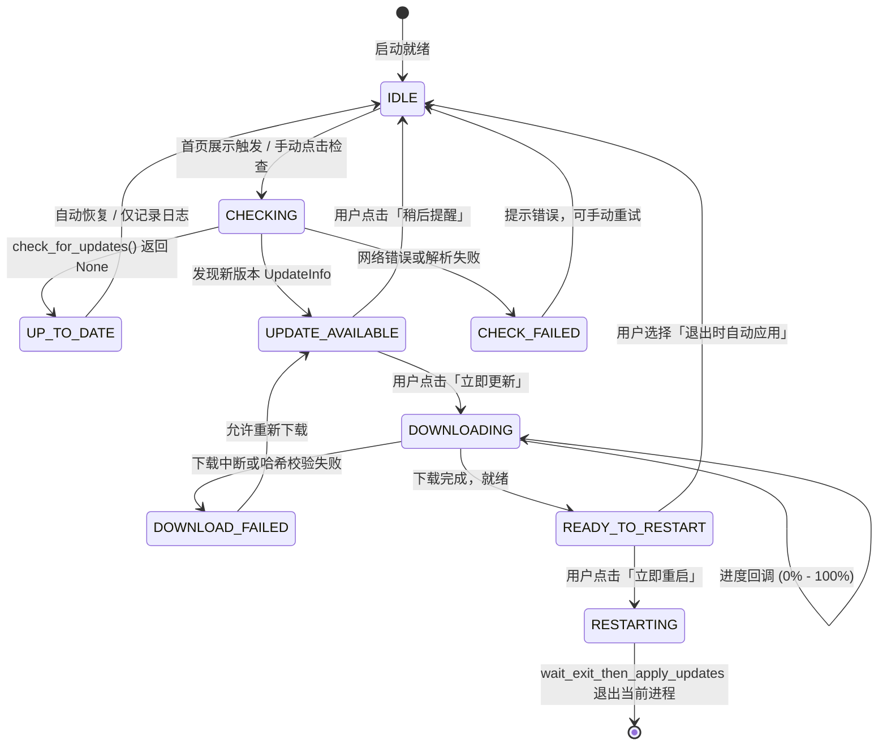

# ZenlessZoneZero-OneDragon 改用 Velopack 分发与自动升级技术设计

- **关联 Issue**：PLAY-2 / PLAY-3
- **目标分支**：`feat/velopack`
- **设计状态**：待评审（In Review - 返工修改版）

---

## 0. 工作区安全与主仓推送防护

- **执行环境**：工作区机器为 `arm-1`（aarch64 Linux），路径固定为 `/home/ubuntu/work/ZenlessZoneZero-OneDragon`。
- **防止误推主仓措施（Dev 阶段第一步执行）**：
  为彻底防止后续开发阶段或自动化脚本误触发向主仓的推送，**Dev 必须在进入任何代码编写前的第一步执行以下命令**：
  ```bash
  git remote set-url --push origin DISABLED
  ```
  执行后，任何向 `origin` 的 push 操作都会被 Git 客户端直接拒绝并报错（当前 arm-1 仓库已执行该配置生效），物理杜绝误推主仓风险。
- **远端推送纪律**：
  所有阶段一律**不推 fork、不配推送凭据、不跑 GitHub Actions**。arm-1 仅作为本地编辑与单测环境，代码只在本地分支 `feat/velopack` 提交，后续由人类直接拉取。

---

## 1. 改动清单

本清单覆盖父单 PLAY-2「落地要点 1–6」以及「尚未完成」全部任务项。

| 文件路径 | 变更类型 | 改动内容简述 | 关键接口签名 | 主要调用点 |
| :--- | :--- | :--- | :--- | :--- |
| `pyproject.toml` | 修改 | 添加 `velopack==1.2.161` 依赖项 | 声明依赖 | `uv sync`, `pip install` |
| `src/one_dragon/utils/os_utils.py` | 修改 | 适配 Velopack 目录层级契约与运行模式识别 | `get_velopack_root() -> Path \| None`<br>`is_velopack_mode() -> bool`<br>`get_bundle_dir() -> Path \| None`<br>`get_work_dir() -> str` | `app.py::main`<br>`bundle_seed.py`<br>`updater.py`<br>`git_service.py` |
| `src/one_dragon/utils/bundle_seed.py` | 新增 | 冻结环境首次启动与升级后资源初始化与配置补齐 | `ensure_work_dir_ready() -> None` | `src/zzz_od/gui/app.py::main()` |
| `src/one_dragon/utils/updater.py` | 新增 | Velopack Python SDK 封装（生命周期钩子、更新检查、下载与就地应用） | `init_velopack() -> None`<br>`is_supported() -> bool`<br>`get_update_source(project_config) -> IUpdateSource`<br>`check_for_updates() -> UpdateInfo \| None`<br>`download_and_apply(update_info, callback, restart=True) -> None` | `src/zzz_od/gui/app.py::main()`<br>`src/zzz_od/gui/view/home/home_interface.py` |
| `src/zzz_od/gui/app.py` | 修改 | 启动最早阶段插入 `init_velopack()` 与 `ensure_work_dir_ready()`；版本检查与遥测跳过 Git 调用 | `main() -> None`<br>`CheckVersionRunner.run() -> None` | 进程启动入口、主窗口初始化 |
| `deploy/OneDragon-Portable.spec` | 新增 | 单目录 PyInstaller 规范：全量收集 `src/`，嵌入四类只读资源与基础配置，集成 velopack 原生二进制 | PyInstaller Analysis / EXE / COLLECT | CI 构建流水线、开发者本地构建 |
| `src/one_dragon/envs/git_service.py` | 修改 | 在 Velopack 模式或缺失 `.git` 时全面短路，杜绝抛出 `ValueError` 及多源轮询重试 | `check_repo_exists() -> bool`<br>`is_current_branch_latest() -> tuple[bool, str]`<br>`fetch_total_commit() -> int`<br>`fetch_page_commit(page_num, page_size) -> list[GitLog]`<br>`get_current_version() -> str \| None`<br>`get_head_commit_id(short=False) -> str \| None`<br>`get_current_branch() -> str \| None`<br>`fetch_latest_code(...) -> tuple[GitSyncStatus, str]` | `CheckVersionRunner`<br>`CodeInstallCard`<br>`ResourceManagementInterface`<br>`telemetry_manager.py` |
| `src/one_dragon_qt/widgets/install_card/code_install_card.py` | 修改 | 界面卡片在 Velopack 模式下展示「发行版（自动升级）」，短路分支和同步按钮 | `get_display_content() -> tuple[QIcon, str]` | `ResourceManagementInterface` |
| `src/one_dragon_qt/view/resource_management_interface.py` | 修改 | 资源管理页隐藏/禁用 Git 代码卡片与旧启动器卡片，停用提交记录轮询线程 | `get_content_widget() -> QWidget`<br>`on_interface_shown() -> None` | 资源管理导航入口 |
| `src/one_dragon_qt/services/resource_update_coordinator.py` | 修改 | 在 Velopack 模式下取消向协调器注册旧版 `launcher` 检查任务 | `__init__(ctx, parent=None)` | 启动初始化聚合更新弹窗 |
| `src/zzz_od/telemetry/telemetry_manager.py` | 修改 | 遥测采集跳过 Git HEAD 查询，Velopack 模式下填充固定标识或空串 | `_get_commit_version() -> str` | `TelemetryManager.initialize()` |
| `src/zzz_od/gui/view/home/home_interface.py` | 修改 | 首页更新流程由旧启动器检查改为基于 `updater.py` 的异步更新状态流 | `_init_update_runner() -> None`<br>`_on_update_status_changed(...)` | `HomeInterface.on_interface_shown()` |
| `tools/ci/get_version.py` | 修改 | 输出版本号转为标准 SemVer 2.0.0（剥离 `v` 前缀供 Velopack 打包），Tag 保留 `v` 前缀 | `main() -> int` | GitHub Actions `version` job |
| `.github/workflows/build-release.yml` | 修改 | 移除旧多 spec 构建与 `src` 复制步骤；接入 `deploy/OneDragon-Portable.spec` 与 `vpk pack --runtime win-x64`；调整非发布构建路径与 SignPath 签名矩阵 | Actions YAML | CI/CD 发布流程 |
| `tools/ci/prepare_release_assets.py` | 修改 | 废除旧 RuntimeLauncher/Launcher 打包逻辑；生成独立的离线模型包 `ZenlessZoneZero-OneDragon-Models.zip` 并组织发布物料 | `main() -> int` | GitHub Actions `release` job |
| `deploy/generate_module_manifest.py` | 删除 | 移除已废弃的模块清单生成工具 | — | 原旧版 RuntimeLauncher |
| `deploy/module_manifest.py` | 删除 | 移除已废弃的模块清单文件 | — | 原旧版 RuntimeLauncher |
| `deploy/hook_path_inject.py` | 删除 | 移除外置 `src/` 路径注入运行时 hook | — | 原旧版 PyInstaller 动态路径扩展 |
| `deploy/OneDragon-RuntimeLauncher.spec` | 删除 | 移除集成版启动器 spec | — | 旧构建流程 |
| `deploy/OneDragon-Launcher.spec` | 删除 | 移除源码版启动器 spec | — | 旧构建流程 |
| `deploy/OneDragon-Installer.spec` | 删除 | 移除旧安装器 spec | — | 旧构建流程 |
| `src/one_dragon/launcher/runtime_launcher.py` | 修改 | 删除 `_sync_code()` 及其引发 Git 同步的代码逻辑，保留基础抽象或平滑过渡 | `_sync_code()` 移除 | 外部启动脚本 |
| `docs/develop/one_dragon/runtime_launcher.md` | 删除 | 移除已废弃的集成启动器开发设计文档 | — | 文档维护 |

---

## 2. git_service 降级设计

### 2.1 报错根因与调用链定位

在冻结二进制（Frozen）运行模式下，分发目录不存在 `.git/` 文件夹。
当业务代码触发 Git 操作时，进入以下异常传播链：

1. **底层报错源**：
   `src/one_dragon/envs/git_service.py:608`
   ```python
   def _open_repo(self, refresh: bool = False) -> Repository:
       ...
       git_dir = discover_repository(self.repo_dir)
       if not git_dir:
           raise ValueError(f'目录 {self.repo_dir} 不是有效的 Git 仓库')
   ```
2. **多源回退与循环放大**：
   `src/one_dragon/envs/git_service.py:1208` (`_fetch_remote`)
   在进行远程同步或更新检查时，遍历 `_get_repository_candidates()` 候选列表（GitHub、Gitee、CNB 共 3 个代码源）。每个代码源均调用 `_fetch_remote_once()`（第 949 行 `repo = self._open_repo()`），捕获到 `ValueError` 后记录 warning 并附带完整异常堆栈（`exc_info=True`），导致 1 次检测产生 3 次严重日志污染。
   上层若有定时器或循环触发（如 50 秒内 72 轮检测），日志将瞬间被几百条 `ValueError` 刷屏。

### 2.2 调用链与短路方案对照表

| 序号 | 触发入口与调用链 | 当前源码位置（文件:行号） | 触发时机 | Velopack 模式下短路方案 |
| :--- | :--- | :--- | :--- | :--- |
| 1 | `GitService._open_repo` | `src/one_dragon/envs/git_service.py:608` | 任意底层 Git 操作 | 增加入口守卫：若 `is_velopack_mode()` 或 `discover_repository` 为空，直接抛出受控自定义异常或在公共 API 层截断，禁止进入 `Repository(git_dir)`。 |
| 2 | `GitService.is_current_branch_latest` | `src/one_dragon/envs/git_service.py:1730` | 状态检测、界面刷新 | 头部短路：<br>`if is_velopack_mode() or not self.check_repo_exists(): return True, ''`<br>直接声明已是最新，阻断 `_fetch_remote()` 多源循环。 |
| 3 | `GitService.fetch_total_commit` | `src/one_dragon/envs/git_service.py:1752` | 历史记录页初始化 | 头部短路：<br>`if is_velopack_mode() or not self.check_repo_exists(): return 0`<br>避免调用 `_get_commit_walker()`。 |
| 4 | `GitService.fetch_page_commit` | `src/one_dragon/envs/git_service.py:1760` | 版本日志分页查询 | 头部短路：<br>`if is_velopack_mode() or not self.check_repo_exists(): return []` |
| 5 | `GitService.get_current_version` | `src/one_dragon/envs/git_service.py:1826` | 启动版本展示、日志记录 | 头部短路：<br>`if is_velopack_mode() or not self.check_repo_exists(): return None`<br>（或返回应用打包内嵌版本 `__version__`），阻断 `fetch_page_commit(0, 1)`。 |
| 6 | `GitService.get_head_commit_id` | `src/one_dragon/envs/git_service.py:1721` | 遥测初始化、调试日志 | 头部短路：<br>`if is_velopack_mode() or not self.check_repo_exists(): return None` |
| 7 | `GitService.get_current_branch` | `src/one_dragon/envs/git_service.py:1708` | 卡片分支文本渲染 | 头部短路：<br>`if is_velopack_mode() or not self.check_repo_exists(): return None` |
| 8 | `GitService.get_latest_tag` | `src/one_dragon/envs/git_service.py:1833` | 旧启动器版本比对 | 当前第 1840 行已有 `if not self.check_repo_exists(): return '', ''`，但 `check_repo_exists()` 应前置判定 `if is_velopack_mode(): return False`，彻底避免 `discover_repository` 文件系统 I/O。 |
| 9 | `GitService.fetch_latest_code` | `src/one_dragon/envs/git_service.py:1692` | 用户点击手动代码同步 | 头部短路：<br>`if is_velopack_mode(): return GitSyncStatus.SUCCESS, '当前为自动升级版本，无需同步源码'` |
| 10 | `GitService.update_remote` | `src/one_dragon/envs/git_service.py:1791` | 代码源下拉切换时触发 | 头部短路：<br>`if is_velopack_mode() or not self.check_repo_exists(): return` |
| 11 | `GitService.reset_to_commit` | `src/one_dragon/envs/git_service.py:1803` | 版本回滚弹窗确认 | 头部短路：<br>`if is_velopack_mode() or not self.check_repo_exists(): return False, 'Velopack 模式不支持回滚'` |
| 12 | 启动版本线程 `CheckVersionRunner` | `src/zzz_od/gui/app.py:50` | 应用启动后主窗口加载 | 判断 `if is_velopack_mode(): code_version = "velopack"`，不调用 `git_service.get_current_version()`。 |
| 13 | 遥测管理器 `TelemetryManager._get_commit_version` | `src/zzz_od/telemetry/telemetry_manager.py:110` | 遥测事件上报（所有事件通用字段） | 修改为：<br>`if is_velopack_mode(): return "velopack"`<br>避免进入 `git_service.get_head_commit_id()`。 |
| 14 | 资源管理页代码卡片 `CodeInstallCard` | `src/one_dragon_qt/widgets/install_card/code_install_card.py:96, 104` | 资源管理界面显示 | 在 `get_display_content()` 中增加 `is_velopack_mode()` 分支：返回 `(FluentIcon.INFO, '已通过 Velopack 自动维护')`，禁用同步按钮；或在父容器中直接隐藏该卡片。 |
| 15 | 资源管理页初始化 `ResourceManagementInterface` | `src/one_dragon_qt/view/resource_management_interface.py:122, 616, 713` | 页面创建及展示 | 在 `is_velopack_mode()` 下，不启动 `fetch_total_runner`，隐藏 `self.code_card`、`self.launcher_opt`，隐藏「版本记录」与「代码设置」按钮。 |
| 16 | 聚合更新协调器 `ResourceUpdateCoordinator` | `src/one_dragon_qt/services/resource_update_coordinator.py:98` | 首页显示时触发检查 | `is_velopack_mode()` 下注销/跳过 `launcher` 维度的更新检查（不再调用 `update_service.is_launcher_update_available()`）。 |
| 17 | 首页旧更新检测（历史兼容） | `src/zzz_od/gui/view/home/home_interface.py:499`（原 `_check_code_runner`） | 首页展示 (`on_interface_shown`) | 说明：当前分支已在 v2.5.2 重构移除了历史上的 `_check_code_runner`，统一收拢至主窗口协调器。Velopack 更新将作为独立生命周期直接托管给 `updater.py`。 |

---

## 3. 首页更新流程与 UI 交互设计

### 3.1 现状与改造点分析

- **当前逻辑**：
  首页 `home_interface.py:499` 在 `on_interface_shown` 时调用主窗口的 `check_resource_updates()`。主窗口通过 `ResourceUpdateCoordinator` 分别对 `launcher`（旧启动器）、`project_models`（模型）和 `plugins` 进行后台线程检查。检查完成后，若存在更新且欢迎弹窗已关闭，弹出一个通用的 `ResourceUpdateDialog` 多选弹窗，用户勾选后放入进程内的 `DownloadQueueService` 串行下载。
- **Velopack 升级机制的根本区别**：
  Velopack 更新是整应用生命周期管理（基于 `UpdateManager` 与 `Update.exe`），更新包下载的是 `.nupkg` 增量或全量差分包，且更新应用需要调用 `wait_exit_then_apply_updates()`，在主进程退出后由外部进程原子替换 `current/` 目录并重启。它**不能也不应混入**通用的文件下载队列。

### 3.2 改造后状态机流转



### 3.3 组件复用方案（G1 评审通过落地项）

经过 Leader 判定，**本轮不派发 Designer**，100% 复用现有 Fluent 控件闭环实现更新流程：

1. **检查与发现阶段**：
   - 使用 `one_dragon_qt` 现有的 `InfoBar.info` 弹出浮层：
     - 标题：`发现新版本 vX.Y.Z`
     - 内容：`已有更新就绪，是否立即下载？`
     - 挂载自定义按钮：`PillPushButton('下载更新')` 与 `PushButton('忽略')`。
2. **下载进度阶段**：
   - 弹出标准 `MessageBoxBase` 派生的轻量进度弹窗，内嵌 `qfluentwidgets.ProgressBar` 与进度文本标签；或复用 `NoticeCard` 区域展示微型进度条。
3. **就绪与重启阶段**：
   - 弹出 `InfoBar.success` 或模态弹窗：
     - 标题：`更新已就绪`
     - 内容：`新版本已下载完毕，重启应用即可生效。`
     - 按钮：`立即重启`（触发退出并调用 `wait_exit_then_apply_updates`）和 `下次启动时应用`。

---

## 4. CI 改造与非发布构建设计

> [!NOTE]
> **执行约束说明**：
> 本设计文档包含完整的 `.github/workflows/build-release.yml`、`tools/ci/get_version.py`、`tools/ci/prepare_release_assets.py` 改造规范，并作为源码变更写入仓库。但在当前研发阶段中，**不推远端、不配置外部凭据、不实际触发 GitHub Actions 执行**。

### 4.1 `.github/workflows/build-release.yml` 改造前后步骤对照

```
改造前 (Legacy Build)                       改造后 (Velopack Build)
────────────────────────────────────────────────────────────────────────────
1. setup-python / uv sync                    1. setup-python / uv sync
2. UPX 下载与解压                            2. (移除 UPX，Velopack 官方建议禁用 UPX)
3. 打包三个可执行文件：                       3. PyInstaller 单目录构建：
   - OneDragon-Installer.spec                   - OneDragon-Portable.spec
   - OneDragon-Launcher.spec                      产物：deploy/dist/OneDragon/
   - OneDragon-RuntimeLauncher.spec
4. Copy-Item ..\src 到 RuntimeLauncher       4. (移除源码外置拷贝，代码已全量打包)
5. Bundle wheels (Environment.zip)          5. (移除 wheels 导出与打包)
6. 准备发布物料 (prepare_release_assets.py):  6. 安装 Velopack CLI：
   - 下载嵌入式 cpython 运行时                   - dotnet tool install -g vpk
   - 多次 zip 打包生成 Full/WithRuntime 等    7. 执行 vpk pack 打包，过程中自动调用签名钩子
                                                (--signTemplate / --signParams)，
                                                对 OneDragon.exe、Update.exe、Setup.exe
                                                在封包前一次性完成数字签名
                                             8. 构建离线模型包 (assets/models)
                                             9. 发布分支创建 Release 或非发布上传 Artifacts
```

### 4.2 非发布构建路径与正式发布隔离防护

为支持在 fork 仓手动测试（`workflow_dispatch`）或给 PR 打 `build` 标签进行构建检验，流水线必须具备严格的非发布构建路径与安全防护机制：

1. **触发条件与上下文环境变量**：
   ```yaml
   env:
     # 仅当为 tag 推送，或在主仓手动触发并显式勾选 create_release 时，才置为 true
     CREATE_RELEASE: ${{ github.repository_owner == 'OneDragon-Anything' && ((github.event_name == 'workflow_dispatch' && inputs.create_release == true) || startsWith(github.ref, 'refs/tags/v')) }}
   ```
2. **非发布构建逻辑（只出 Artifact，不建 Release、不跑 SignPath）**：
   - **打包与 Pack 正常执行**：在 `windows-latest` runner 上运行 PyInstaller 与 `vpk pack --runtime win-x64`（未配置签名钩子时输出未签名的测试包）。
   - **SignPath 门禁拦截**：
     ```yaml
     sign:
       if: ${{ env.CREATE_RELEASE == 'true' }}
     ```
     非发布构建跳过所有 SignPath 步骤，不需要任何 `SIGNPATH_API_TOKEN` 或签名组织凭据。
   - **Artifact 收集与上传**：
     非发布构建时，通过 `actions/upload-artifact@v4` 将产物完整导出供下载验证：
     - `ZenlessZoneZero-OneDragon-Setup.exe`
     - `ZenlessZoneZero-OneDragon-win-Portable.zip`
     - `RELEASES`
     - `releases.win.json`
     - `*.nupkg`
   - **Release 门禁拦截**：
     ```yaml
     release:
       if: ${{ env.CREATE_RELEASE == 'true' }}
     ```
     彻底杜绝非发布构建误建 Release、打 Git Tag 或向 CNB 发起镜像同步。

### 4.3 规范 vpk pack 执行命令

在 Windows Runner 的 PowerShell 环境下，执行以下打包命令（发布模式挂接 `--signTemplate`，测试模式不带签名）：

```powershell
# 1. 安装并信任 vpk 工具
dotnet tool install -g vpk

# 2. 提取剔除前导 v 的 SemVer 2.0.0 版本号
$rawVersion = "${{ needs.version.outputs.version }}"
$semver = $rawVersion.TrimStart('v')

# 3. 执行打包（必须带 --runtime win-x64）
vpk pack `
  --packId "ZenlessZoneZero-OneDragon" `
  --packVersion "$semver" `
  --packDir "deploy\dist\OneDragon" `
  --mainExe "OneDragon.exe" `
  --icon "assets\ui\logo.ico" `
  --runtime win-x64 `
  --packTitle "ZenlessZoneZero-OneDragon" `
  --packAuthors "OneDragon-Anything" `
  --outputDir "deploy\dist\releases"
```

> [!WARNING]
> **关键约束**：
> 1. 必须带 `--runtime win-x64`。若省略，vpk 默认打包为 win-x86，将导致 64 位 CPython 动态库加载失败引发崩溃。
> 2. 版本号必须剔除前导 `v`（符合 SemVer 2.0.0 规范，如 `0.1.0-beta.1`）。

### 4.4 签名机制与 SignPath 整合规范（统一口径）

> [!CRITICAL]
> **签名顺序的核心问题与官方规范**：
> - **问题根因**：`Update.exe` 和主程序 `OneDragon.exe` 在 `vpk pack` 执行期间就会被封装进 `Portable.zip` 和 `.nupkg` 内部。如果在 `vpk pack` 之后单独对输出目录的 `Update.exe` 签名，压缩包内的 `Update.exe` 依然是**未签名状态**，导致便携版用户解压升级时触发系统拦截。
> - **官方文档出处**：Velopack 官方代码签名文档 `docs/packaging/signing.mdx`（[Signing | Velopack Documentation](https://github.com/velopack/velopack.docs/blob/master/docs/packaging/signing.mdx)）

#### 机制说明
Velopack 官方原生支持在打包过程中对全部二进制执行原子签名钩子：
- `--signParams <PARAMS>`：使用系统 `signtool.exe`，将签名参数直接传递给签名工具（如 `/a /td sha256 /fd sha256`）。
- `--signTemplate <TEMPLATE>`：自定义签名命令模板，Velopack 在打包过程中自动将当前待签名二进制文件替换入 `{{file}}` 占位符。

#### 打包执行时 Velopack 的内置调用时序
1. **主程序签名**：遍历 `--packDir`，调用签名钩子对主程序（`OneDragon.exe`）及原生依赖完成签名；
2. **更新存根签名**：生成便携版更新存根 `Update.exe`，调用签名钩子对 `Update.exe` 完成签名；
3. **安全封包**：将上述已签名的 `OneDragon.exe` 与 `Update.exe` 封装进 `Portable.zip` 和 `.nupkg`；
4. **安装器签名**：编译安装向导 `Setup.exe`，并对最终的 `Setup.exe` 调用签名钩子完成签名。

#### CI 正式发布流水线中的 SignPath 接入方案
CI 在正式发布（`CREATE_RELEASE == 'true'`）时，通过 `--signTemplate` 调用 SignPath 逐文件签名脚本或本地代理工具：
```powershell
# 编写轻量签名桥接脚本 tools/ci/sign_file.py 调用 SignPath API
vpk pack `
  --packId "ZenlessZoneZero-OneDragon" `
  --packVersion "$semver" `
  --packDir "deploy\dist\OneDragon" `
  --mainExe "OneDragon.exe" `
  --runtime win-x64 `
  --signTemplate "python tools/ci/sign_file.py {{file}}" `
  --outputDir "deploy\dist\releases"
```
*(注：如果采用 GitHub Actions 云端打包签名，等效做法为：在 pack 前提取 `OneDragon.exe` 与 vpk 内置的 `Update.exe` 提交 SignPath 云端签名，回填已签名文件后再执行 pack，最后对产出的 `Setup.exe` 签名。无论何种做法，必须保证主 exe、Update.exe、Setup.exe 全部在封包闭环中受签名保护)*。

### 4.5 离线模型包来源、生成与解压契约

#### 来源定义与配置复用（精确代码位置）
离线模型包**严格复用现有代码库的声明与下载逻辑**，不新建独立配置或散落 URL：
- **配置来源**：`tools/ci/prepare_release_assets.py:214-250` 中的 `_MODEL_CONFIGS` 列表。
  具体包含 4 类必须模型：
  1. `ppocrv6`: 仓库 `OneDragon-Anything/OneDragon-Env`，文件名正则 `ppocrv6\.zip$`，目标目录 `assets/models/onnx_ocr`，降级下载地址为 `https://github.com/OneDragon-Anything/OneDragon-Env/releases/download/ppocrv6/ppocrv6.zip`。
  2. `flash`: 仓库 `OneDragon-Anything/OneDragon-YOLO`，文件名正则 `flash.*\.zip$`，目标目录 `assets/models/flash_classifier`，降级下载地址为 `https://github.com/OneDragon-Anything/OneDragon-YOLO/releases/download/zzz_model/yolov8n-640-flash-0127.zip`。
  3. `hollow`: 仓库 `OneDragon-Anything/OneDragon-YOLO`，文件名正则 `hollow.*\.zip$`，目标目录 `assets/models/hollow_zero_event`，降级下载地址为 `https://github.com/OneDragon-Anything/OneDragon-YOLO/releases/download/zzz_model/yolov8s-736-hollow-zero-event-0126.zip`。
  4. `lost_void_det`: 仓库 `OneDragon-Anything/OneDragon-YOLO`，文件名正则 `lost.*\.zip$`，目标目录 `assets/models/lost_void_det`，降级下载地址为 `https://github.com/OneDragon-Anything/OneDragon-YOLO/releases/download/zzz_model/yolov8n-736-lost-void-det-20250612.zip`。
- **下载实现逻辑复用**：直接调用 `tools/ci/prepare_release_assets.py:251` 中的现有函数：
  ```python
  def _download_models(model_base: Path, temp_dir: Path, *, token: str | None) -> None
  ```

#### Zip 目录结构与根层解压契约
离线模型包由 `tools/ci/prepare_release_assets.py:202` 的 `_write_dir_contents` 生成，内部具有严格的 `assets/models` 根前缀：
```text
ZenlessZoneZero-OneDragon-Models.zip
└── assets/
    └── models/
        ├── onnx_ocr/
        │   └── ppocrv6/
        ├── flash_classifier/
        │   └── yolov8n-640-flash-0127/
        ├── hollow_zero_event/
        │   └── yolov8s-736-hollow-zero-event-0126/
        └── lost_void_det/
            └── yolov8n-736-lost-void-det-20250612/
```
用户下载该附件后，解压到程序根目录 `<RootAppDir>`，文件将自动精准落入 `<RootAppDir>/assets/models/<类别>/<模型名>/...`，与应用运行时代码契约完全重合，实现解压即离线可用。

---

## 5. 验证矩阵

根据人类最终拍板意见：**验证矩阵精简为两栏，严谨划分「arm-1 上验到哪一步（mock 单测只证明逻辑，不等于验收通过）」与「交人类在 Windows 上验（未验，附可直接执行的步骤与断言）」**：

| 验收标准 | 栏目 1：arm-1 上验到哪一步（mock 单测只证明逻辑，不等于验收通过） | 栏目 2：交人类在 Windows 上验（未验，附可直接执行的步骤与断言） |
| :--- | :--- | :--- |
| **1. `vpk pack` 一条命令产出 `Setup.exe` 与 `Portable.zip`，两者都能装/解压后启动** | 1. 运行 `ruff check src/ deploy/ tools/` 校验代码规范；<br>2. 运行单测静态解析 `OneDragon-Portable.spec`，断言入口、datas 资源路径存在性；<br>3. 校验 `pyproject.toml` 语法。<br>*(不能在 arm-1 上构建 exe，不代表打包通过)* | **人类 Windows 验证步骤（同一份代码连续 pack 两次完整命令）**：<br>1. 先用 PyInstaller 构建出一份单目录产物：<br>   `cd deploy; pyinstaller OneDragon-Portable.spec --noconfirm --clean`<br>2. 打包第 1 个版本（`0.1.0-beta.1`）：<br>   `vpk pack --packId ZenlessZoneZero-OneDragon --packVersion 0.1.0-beta.1 --packDir deploy\dist\OneDragon --mainExe OneDragon.exe --runtime win-x64 --outputDir deploy\dist\releases`<br>3. 同一份代码打包第 2 个版本（`0.1.0-beta.2`，**输出到同一个 outputDir**）：<br>   `vpk pack --packId ZenlessZoneZero-OneDragon --packVersion 0.1.0-beta.2 --packDir deploy\dist\OneDragon --mainExe OneDragon.exe --runtime win-x64 --outputDir deploy\dist\releases`<br>4. 断言目录正确生成 `Setup.exe`、`win-Portable.zip`、`RELEASES`、`releases.win.json` 与 `.nupkg`；安装 Setup.exe 与解压 Portable 双击启动验证。 |
| **2. 解压到全新目录启动后，根层自动生成 `config/assets/custom/.log`，四类只读资源到位** | **单测 Mock 覆盖（只证明逻辑正确）**：<br>编写 `tests/test_bundle_seed.py`：<br>1. Mock `sys.frozen=True`, `sys.executable="/mock/app/current/OneDragon.exe"`, `sys._MEIPASS="/mock/bundle"`;<br>2. 模拟全新空目录执行 `ensure_work_dir_ready()`；<br>3. 断言四类只读目录文件复制与 `.bundle_seed_version` 写入。 | **人类 Windows 验证步骤（含直接粘贴的 PowerShell 计数命令）**：<br>1. 将生成的 `ZenlessZoneZero-OneDragon-win-Portable.zip` 解压至全新空目录（如 `C:\TestOneDragon`）；<br>2. 启动根层 `OneDragon.exe`，等待 30–60 秒完成首启播种；<br>3. **断言目录生成**：检查根层存在 `config`、`assets`、`custom`、`.log`；<br>4. **断言文件数基准（可直接粘贴执行的 PowerShell 命令）**：<br>   `(Get-ChildItem -Path .\assets\template -Recurse -File).Count` 断言等于 **1820**<br>   `(Get-ChildItem -Path .\assets\ui -Recurse -File).Count` 断言等于 **10**<br>   `(Get-ChildItem -Path .\assets\text -Recurse -File).Count` 断言等于 **8**<br>   `(Get-ChildItem -Path .\assets\game_data -Recurse -File).Count` 断言等于 **178**<br>5. 验证完成后结束/终止进程。 |
| **3. 改根层 `config/project.yml` 后升级，改动保留、`current/` 被替换** | **单测 Mock 覆盖（只证明逻辑正确）**：<br>1. 预置含用户自定义字段（如 `test_key: custom_val`）的 `config/project.yml`；<br>2. 模拟新版本环境执行 `ensure_work_dir_ready()`；<br>3. 断言用户自定义配置未被覆盖，只读资源得到更新。 | **人类 Windows 验证步骤（就地升级断言）**：<br>1. 在第 2 步的运行环境中，修改根层 `config/project.yml`（追加一行 `test_custom_marker: "verified"`）；<br>2. 在命令行执行升级应用：<br>   `.\Update.exe apply -p deploy\dist\releases\ZenlessZoneZero-OneDragon-0.1.0-beta.2-full.nupkg --norestart`<br>3. **断言版本升级**：检查 `current/sq.version` 文件，确认内容已变为 `0.1.0-beta.2`；<br>4. **断言配置保留**：打开 `config/project.yml`，断言此前添加的 `test_custom_marker` 依然完好保留。 |
| **4. 完整日志里不再出现「不是有效的 Git 仓库」** | **单测 Mock 覆盖（只证明逻辑正确）**：<br>编写 `tests/test_git_service_fallback.py`：<br>1. Mock `is_velopack_mode() = True` 且工作目录无 `.git`；<br>2. 遍历调用 `is_current_branch_latest`、`fetch_total_commit`、`fetch_page_commit`、`get_current_version`、`get_head_commit_id`、`telemetry.initialize()`；<br>3. 断言日志中零次出现 `ValueError: 目录 xxx 不是有效的 Git 仓库` 且无多源重试 warning。 | **人类 Windows 验证步骤（日志检索）**：<br>1. 升级完成后，再次双击启动根层 `OneDragon.exe`；<br>2. 打开应用后正常浏览各界面约 1 分钟；<br>3. 在 PowerShell 执行日志检索：<br>   `Get-ChildItem -Path .\.log\*.log \| Select-String -Pattern "不是有效的 Git 仓库"`<br>4. **断言检索命中数为 0**。 |
| **5. 源码模式 `python main.py` 行为与改造前一致** | **直接运行验证**：<br>1. 在 arm-1 上执行 `python3 main.py` 确保入口无语法或依赖缺失；<br>2. 断言 `is_velopack_mode()` 为 `False`；<br>3. 断言 `get_work_dir()` 正确解析为仓库根目录；<br>4. 执行既有测试套件 `pytest tests/` 全部通过。 | **人类 Windows 验证步骤**：<br>1. 在 Windows 开发环境拉取该分支；<br>2. 运行 `python main.py` 启动 GUI，测试核心自动化任务，确认与改造前完全一致。 |
| **6. 跑完清理掉启动的进程，不留后台** | **代码走查说明**：<br>代码走查 `updater.py` 与 `app.py::closeEvent` 退出逻辑。<br>*(注：此项在 arm-1 上仅为静态代码走查，不等于验收通过；冻结版进程清理交人类真机任务管理器验证)* | **人类 Windows 验证步骤**：<br>1. 启动 `OneDragon.exe` 运行任务，正常点击右上角关闭按钮退出应用；<br>2. 打开任务管理器（Task Manager）的「详细信息」页面；<br>3. **断言无残留进程**：确认无任何残留的 `OneDragon.exe`、`Update.exe` 或孤儿 Python 进程。<br>*注：对于「点击界面更新按钮、肉眼查看窗口渲染」等人工交互细节，直接标为「未验证，写入交付说明供人类验收确认」。* |

---

## 6. 风险评估与应对策略

### 6.1 签名与 Windows SmartScreen 拦截风险（统一口径）
- **风险**：
  若 SignPath 签名遗漏了 `Setup.exe`、`Update.exe` 或 `OneDragon.exe` 中的任何一个，用户在 Windows 10/11 安装或升级时将遭遇 SmartScreen 强力拦截甚至被杀毒软件误杀。尤其若在 `vpk pack` 之后才去签名输出目录中的 `Update.exe`，压缩包 `Portable.zip` 和 `.nupkg` 内部封存的 `Update.exe` 仍为未签名状态。
- **应对策略**：
  统一采用 Velopack 内置的 `--signTemplate` / `--signParams` 原生机制，在 `vpk pack` 执行期间由 Velopack 原子替换待打包的主程序二进制、包内及包外的 `Update.exe` 与编译生成的 `Setup.exe` 进行签名，彻底保证包内外所有二进制全部携带合法数字签名。

### 6.2 发布流水线与国内 CDN 同步风险
- **风险**：
  国内用户主要依赖 CNB 镜像源。Velopack 更新严重依赖 `releases.win.json`、`RELEASES` 以及 `.nupkg` 文件的完整性。如果 CNB Release 同步只同步了 exe 而漏掉了元数据文件，国内用户将全部升级失败。
- **应对策略**：
  更新 `.github/workflows/build-release.yml` 中的 CNB 同步触发逻辑，确保全量物料（包含 `releases.win.json`, `RELEASES`, 所有 `.nupkg`, `Setup.exe`, `Portable.zip`, `ZenlessZoneZero-OneDragon-Models.zip`）作为一个发布事务完整推送。

### 6.3 用户数据目录隔离与迁移破坏风险
- **风险**：
  Velopack 升级机制会在升级时彻底删除并重建 `current/` 文件夹。如果用户或开发人员不小心将数据存储在 `current/` 内部，升级后将导致用户数据永久丢失。
- **应对策略**：
  1. `get_work_dir()` 必须具备高可靠防护，确保在冻结状态下牢牢锚定在 `<RootAppDir>`。
  2. 单元测试针对 `get_velopack_root()` 进行详尽的边界与异常路径覆盖。

### 6.4 旧版本（集成版/源码版）用户的过渡风险
- **风险**：
  老用户目前处于「源码启动器 / 旧 RuntimeLauncher」体系，其目录结构与 Velopack 规范不兼容，无法通过应用内静默升级到 Velopack 版本。
- **应对策略**：
  1. **首发全量升级公告**：发布版本时在 Release Notes、QQ 群及公告卡片明确注明分发体系重构。
  2. **无缝配置迁移指南**：老用户只需下载全新的 `Setup.exe` 或 `Portable.zip`，将旧版本的 `config/` 目录直接拷贝至新程序根目录下即可完全继承所有账号与设置。
